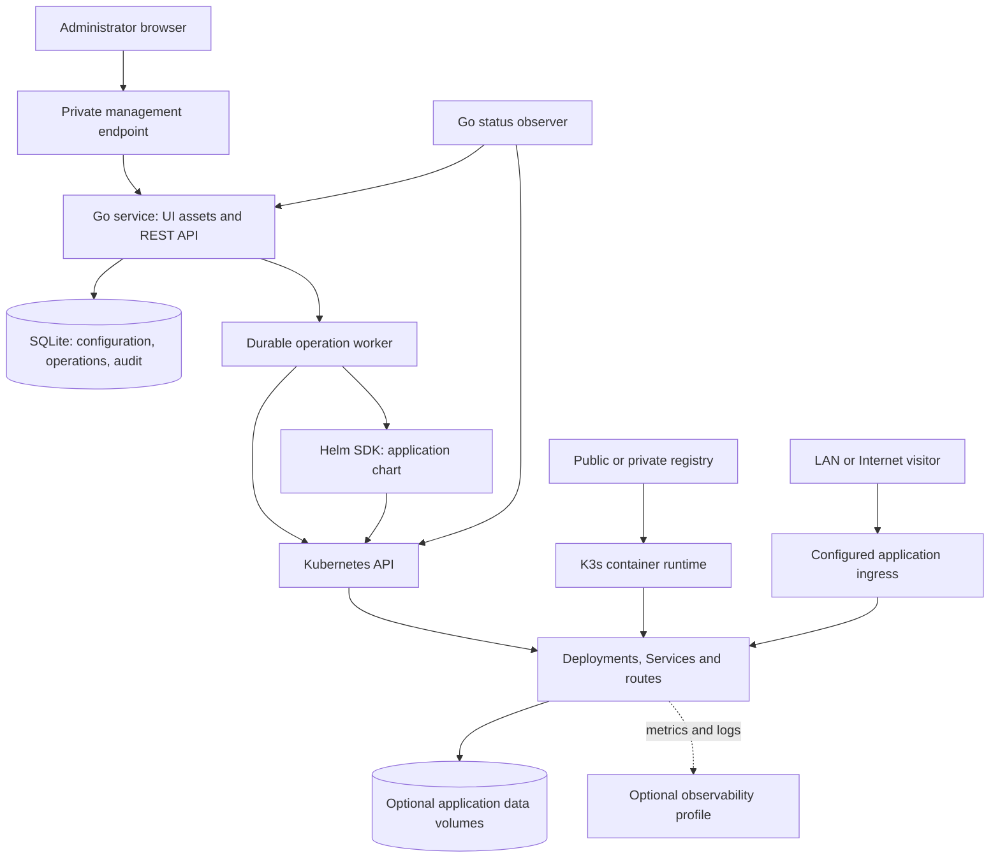
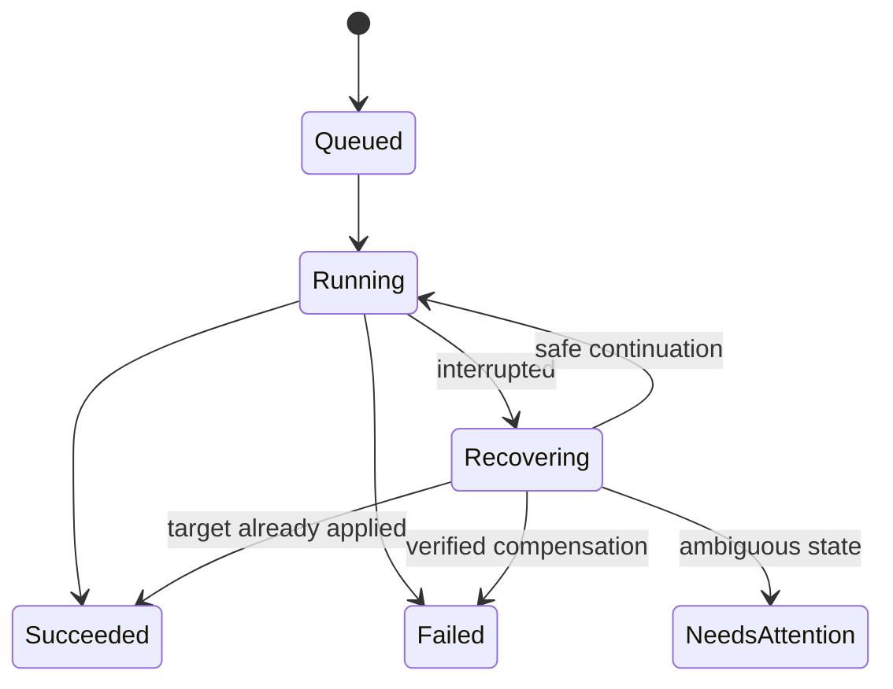

# Application platform implementation plan

Updated: 2026-10-13. Status: proposed implementation plan, with the author's
confirmed requirements recorded below. This document accompanies
[project-outline.md](project-outline.md), which preserves the original thesis
scope and supplied university requirements. This is a plan for building the
software; it does not contain thesis chapters or claim completed implementation.

Navigation: [scope](#2-scope-and-order-of-delivery),
[components](#3-components-and-responsibilities),
[installation](#4-hardware-installation-and-operating-limits),
[application contract](#5-application-contract),
[networking](#6-networking-lan-first-public-access-later),
[UI](#7-ui-structure-and-user-experience),
[data model](#8-platform-data-model-and-traceability),
[API](#9-api-contract),
[recovery](#10-deployment-execution-recovery-and-reconciliation),
[milestones](#15-implementation-milestones-and-completion-criteria),
[evaluation](#16-tests-and-thesis-evaluation).

## 1. Product goal and confirmed decisions

Build a platform that an administrator installs on their own Linux machine.
They open a straightforward web UI, supply a container image and the information
the application needs, and deploy it on their infrastructure. The platform
manages deployment, configuration, updates, recovery, and supported scaling.
An application can later be made publicly accessible over HTTPS.

The reference outcome is to build a separate application, publish its container
image, and run it publicly on the Raspberry Pi hosting this platform.

| Topic | Confirmed requirement |
| --- | --- |
| First host | Raspberry Pi 5, 8 GB RAM, 32 GB microSD, 64-bit Raspberry Pi OS. |
| Operator | One administrator: the person installing the platform. |
| Interface | A web UI is a core part of the product. |
| Application source | Support public and private container images. |
| Operations | Deploy, inspect, update, and scale applications; add the lifecycle operations needed to make these reliable. |
| Traceability | Persist configuration, deployment history, operations, and an audit trail. |
| Initial networking | Develop and demonstrate on the LAN first. A domain will be purchased later. |
| Final networking | Support a publicly accessible application on the Pi. The public connection method is still to be selected. |
| Distribution | Eventually provide installable GitHub releases. |
| Working language | English for project documentation, code, and UI. |

The following are **recommended design choices**, open to revision after the
first implementation experiments: K3s, a Go modular monolith, a React/TypeScript
UI, SQLite for platform metadata, and a platform-owned Helm chart for applications.

The future application's own database, uploads, background jobs, and traffic
requirements are still unknown. They are separate from the platform's database.

### What “give it an image” means

The shortest supported path should be:

1. Paste an image reference.
2. Confirm the suggested application name and listening port.
3. Supply required configuration, if any.
4. Choose an available visibility mode and click **Deploy**.

The platform remembers installation-level networking and registry settings.
It provides defaults for deployment resources and health checks. It cannot infer
every application's required secrets, database, data directory, or correct health
endpoint. Image metadata such as `EXPOSE` is only a hint, not proof that a service
is running or published. [Dockerfile reference](https://docs.docker.com/reference/dockerfile/#expose)

## 2. Scope and order of delivery

Use three completion levels so that the first working version stays achievable.

| Level | Outcome | Included |
| --- | --- | --- |
| Local vertical slice | A real application works on the Pi through the platform. | Manual K3s bootstrap, API, minimal UI, image deployment, status, logs, LAN access, initial update and recovery path. |
| Usable platform | An administrator can operate applications without routine kubectl/Helm commands. | Authentication, public/private images, durable operations, history, reliable update/rollback, manual replicas, retained storage, documented installation and recovery. |
| Thesis demonstration / initial release | Another person can install it and reproduce the main scenarios. | One tested public HTTPS mode, the author's separate app, release artifacts, upgrade/backup procedures, observability evaluation, and repeatable tests. |

The supported starting workload is one long-running Linux HTTP container with
one application port. Add a private TCP service profile when testing a database
or another internal dependency. A frontend and backend can initially be two
applications connected through explicit configuration.

Defer these features until the core works:

- Building source repositories or Dockerfiles on the Pi; importing Docker Compose.
- Arbitrary user-supplied Helm charts, Kubernetes YAML, or shell commands.
- Multi-user organisations, public signup, billing, or isolation of untrusted tenants.
- Multi-cluster management, high availability, distributed storage, and node autoscaling.
- Automated database provisioning, migrations, backups for arbitrary database engines,
  and point-in-time recovery.
- A plugin marketplace, service mesh, canary deployments, and distributed tracing.
- CPU-based application autoscaling; manual replica changes come first.

Tests start with the first working lifecycle operation. Polished release
automation and a large test matrix can follow later.

## 3. Components and responsibilities

### Proposed architecture



The API, worker, and observer are modules inside **one Go service**. They do not
need independent microservices, a message broker, or separate deployments.
The browser communicates only with this service, never directly with Kubernetes.

| Component | Responsibility | Where it runs |
| --- | --- | --- |
| Installer | Host checks, K3s configuration, namespaces/RBAC, platform installation, initial admin access. | On the host, with explicit administrative privileges. |
| K3s | Kubernetes control plane and node services, scheduling, image pulling, networking, restarting containers. | Host service. |
| Web UI | Setup, application forms, status, logs, history, and lifecycle actions. | Built static assets served by the Go service. |
| Go API | Authentication, validation, application model, operation submission, API responses. | One platform pod. |
| Operation worker | Execute persisted deployment work and recover interrupted operations. | Background worker in the Go service. |
| Status observer | Read actual workload state and publish timestamped observations. | Background worker in the Go service. |
| SQLite | Persist platform users, specifications, operations, settings, and audit records. | Platform PVC; one writer process. |
| Helm adapter | Install and change a versioned first-party application chart. | Go Helm SDK, called by the worker. |
| Application chart | Produce standard workload, service, health, resource, and route manifests. | Versioned source shipped with the platform. |
| Traefik | Route HTTP traffic to the correct application. | K3s-provided ingress controller. |
| Certificate component | Issue and renew certificates for the selected direct HTTPS mode. | cert-manager when that mode is implemented. |
| Local storage provisioner | Supply node-local persistent volumes. | K3s storage component. |
| Registry | Store application and platform images. | GHCR, Docker Hub, or another configured registry. |
| Observability profile | Historical metrics/logs, dashboards, and selected alerts. | Optional services sized to the host. |

K3s supplies Traefik and ServiceLB; its default ingress setup uses host ports
80/443. Retain the bundled controller and configure it through supported K3s
mechanisms. Do not install a second public ingress controller by accident.
[K3s networking services](https://docs.k3s.io/networking/networking-services)

Use React with TypeScript as a proposed UI implementation. A static client is
enough; server-side rendering and a separate Node.js runtime are unnecessary for
this administration tool. [React TypeScript support](https://react.dev/learn/typescript)

### Three different kinds of database

| Database | Purpose | Initial choice |
| --- | --- | --- |
| K3s datastore | Kubernetes cluster objects and internal state. | K3s default SQLite for the single-server installation. |
| Platform database | Applications, requested revisions, operations, audit, sessions, and settings. | A separate SQLite database on a platform PVC. |
| Deployed application's database | Data belonging to the author's future application. | Decide when designing that application; possibly PostgreSQL or application-local SQLite. |

These databases have different owners and backup procedures. The platform's
database should not become a shared database for hosted applications.
[K3s datastore options](https://docs.k3s.io/datastore)

### Kubernetes ownership and permissions

Start with installer-created namespaces `platform-system` and `platform-apps`.
The first contains platform components; the second contains managed applications.
Use stable application IDs in resource names and labels.

- The installer performs cluster-level setup, including RBAC and ingress configuration.
- The running broker gets narrowly defined roles for the namespaces it manages,
  plus only the cluster reads required for capacity and diagnostics.
- Helm owns workload manifests; scaling, restarting, and updating all pass through
  the same chart configuration path.
- The broker owns versioned application Secrets and retained PVCs separately from
  the workload release. The chart refers to them by name.
- Application pods receive no Kubernetes API credentials by default.
- Users cannot use the UI to deploy arbitrary cluster-scoped resources.

One namespace per app is a possible later change. It is not required for a
single trusted administrator and would add namespace lifecycle privileges.
The first release is not a security boundary for hostile tenants or untrusted code.

## 4. Hardware, installation, and operating limits

### Reference hardware

Use the confirmed Pi 5 / 8 GB / 32 GB microSD / 64-bit Raspberry Pi OS setup for
early development. Do not require a domain or additional purchases to start.
K3s documents a 2-core/2-GB server baseline excluding application workloads and
recommends SSD storage on Raspberry Pi. An SSD is therefore a recommended later
improvement for sustained use, subject to actual measurements and the author's
decision. [K3s requirements](https://docs.k3s.io/installation/requirements)

Treat 32 GB as a capacity constraint, not as 32 GB freely available to apps:

- Measure free disk after the OS, K3s, and initial images are installed.
- Keep monitoring optional and retention short; do not retain unlimited images,
  application revisions, logs, or metrics.
- Reserve working space for pulling a new image while retaining the old one.
- Display disk pressure and use best-effort admission estimates to reject new
  storage-heavy changes that would consume the configured reserve. Image expansion
  and later data growth still require monitoring; admission is not a disk quota.
- Let the container runtime manage its image cache; never delete its files directly.
- Set admission thresholds after measuring the reference Pi, and record them as
  versioned configuration rather than unsupported performance guarantees.
- Check power supply, cooling, and storage health during physical-host testing.

Default to a lightweight profile. Measure idle CPU/RAM, remaining disk, and the
cost of one representative app before enabling the full monitoring stack.

### Installer workflow

The eventual downloaded package should contain an installer, pinned component
versions, the platform chart, a checksums file, and installation documentation.
Initially the same installer can be run from a source checkout.

1. Run a read-only preflight: OS and architecture, cgroups, disk/RAM, time sync,
   outbound registry access, occupied ports, and network CIDR conflicts.
2. Detect an existing installation or cluster. Refuse to overwrite an unrelated
   cluster. Existing-cluster installation can be a separately tested future mode.
3. Show what will be installed and the selected persistent data location. Do not
   reformat disks or silently rewrite unrelated firewall configuration.
4. Install a pinned K3s release with recorded configuration and secrets encryption.
5. Create namespaces, service accounts, RBAC, network rules, and the platform PVC.
   Keep public listeners disabled or blocked by default until public mode is
   explicitly configured, including on hosts with publicly routed IPv6.
6. Install the platform Helm chart and wait for its readiness check.
7. Provide initial management access over an authenticated SSH tunnel/port forward.
   Show a single-use, expiring bootstrap token to the local administrator.
8. The setup wizard creates the administrator account and configures private
   management access, LAN routing, optional registry credentials, and retention.
9. Run a built-in diagnostic and offer to deploy the demonstration image.
10. Store installation version and progress so rerunning the installer can resume
    safely or explain the failed stage.

Support Linux ARM64 first on the Pi and verify Linux AMD64 as the second target.
Docker Engine is not required on the installed host: K3s runs the containers.
Use Docker/Buildx on a development machine or CI to produce images.

### Upgrade and uninstall

Keep platform upgrades separate from application updates. A host-side upgrade
command first backs up platform state, validates supported version transitions,
and then upgrades the platform chart. Database migrations must have a documented
compatibility or restore strategy; a Helm rollback alone cannot undo a database
migration. Upgrade K3s through a separate documented maintenance procedure.

The first release needs a documented upgrade path and failure recovery, not a
self-updating UI. Uninstall the platform separately from applications, volumes,
and K3s. Report what will remain; deleting stored data must be an explicit action.

### CI/CD and release artifacts

Use GitHub Actions as the proposed CI provider because distribution is planned
through GitHub. Start with formatting/static checks, meaningful Go tests, frontend
type/build checks, chart validation, and a small integration smoke test. Build
images for both supported architectures without running untrusted pull-request
code on the Pi that hosts real applications.

For a tagged release, publish:

- The platform image to GHCR with version tags and recorded immutable digests.
- The application/platform charts and a compatibility manifest pinning their
  versions alongside K3s and other installed dependencies.
- Installer assets for the supported hosts, checksums, upgrade notes, and the
  clean-install procedure. Add signed provenance as release automation matures.
- Demonstration image versions used in smoke and recovery tests.

The separate application's pipeline builds, tests, and pushes its image. Initially
the administrator selects that version in the UI. Later, provide one example
deployment step that calls the same API with an app-scoped token, then polls the
operation until it succeeds or fails. A registry push alone must not silently
update the running app. [GitHub image publishing](https://docs.github.com/en/actions/tutorials/publish-packages/publish-docker-images)

Keep the management endpoint private: automation needs an approved private-network
path, such as a VPN-connected runner or a dedicated trusted deployment runner.
Do not open administration to the Internet just to make CI reach it. Machine
tokens are introduced with this automation phase, stored hashed, revocable, and
limited to the selected app's read/update/operation actions.
[GitHub private runner networking](https://docs.github.com/en/enterprise-cloud%40latest/actions/concepts/runners/private-networking)

## 5. Application contract

### Required and optional input

| Field | Default / behavior |
| --- | --- |
| Name | Suggest a name from the image; administrator can edit it. Validate uniqueness. |
| Image | Existing OCI image reference. Retain the supplied tag and resolved digest. |
| Registry credential | Optional for public images; select or create one for private images. |
| Container port | Suggest from image metadata where possible; require confirmation. |
| Workload profile | HTTP service first; private TCP service added with stateful support. |
| Exposure | Internal, LAN, or public, depending on installed capabilities. |
| Environment | Optional non-sensitive key/value settings. |
| Secrets | Write-only input or references to stored secret versions. |
| Replicas | One initially; manual changes for supported stateless apps. |
| Resources | A tested default request/limit preset, editable within host policy. |
| Readiness | Optional HTTP path; otherwise a documented TCP readiness fallback. |
| Startup check | Configurable startup allowance for applications that need it. |
| Liveness | Optional; enable only with a suitable health endpoint. |
| Storage | Off by default; one retained volume and mount path in the initial persistent profile. |

A compatible application must listen on `0.0.0.0` inside the container, support
the host's Linux CPU architecture, and get runtime settings from the configured
environment or files. It should log to stdout/stderr and handle termination.
Document supported non-root execution and volume permissions; show a useful
compatibility error for an image that needs unsupported privileges.

Inspect the registry manifest before deployment, including authentication and
architecture where possible. Deploy by digest so an existing revision does not
change when a tag moves. If the registry cannot be checked, show a retryable
validation error instead of claiming the image is compatible.
[Kubernetes images](https://kubernetes.io/docs/concepts/containers/images/)

Build platform and demonstration images for `linux/arm64` and `linux/amd64`.
Do not rely on transparent emulation on the Pi.
[Docker multi-platform builds](https://docs.docker.com/build/building/multi-platform/)

### Health and status

Keep these states separate in the API and UI:

- **Operation:** queued, running, recovering, succeeded, failed, or needs attention.
- **Workload:** deploying, updating, ready, degraded, stopped, failed, or unknown.
- **Exposure:** not requested, waiting for configuration, route ready, TLS ready,
  verified reachable, or verification failed.

A successful Helm command or a running pod is not sufficient proof that the
application can serve a request. Check desired versus ready replicas, rollout
generation, and service endpoints. Record observation time and make stale status
visible when the Kubernetes API cannot be reached.

Readiness controls whether a pod receives service traffic; liveness can restart
the container. A startup probe can protect slow startup from premature health
failures. A TCP readiness fallback proves less than an application-specific HTTP
check. [Kubernetes probe behavior](https://kubernetes.io/docs/tasks/configure-pod-container/configure-liveness-readiness-probes/)

### Scaling and persistent storage

For stateless applications, support manual replicas including zero. Zero means
**Stopped**; it is not automatic scale-to-zero or wake-on-request. Show requested
and ready replica counts and scheduling/resource errors. More replicas on one
Pi do not create additional hardware capacity or protect against host failure.

Applications sharing local files, in-memory sessions, or background task ownership
need an application-level scaling design. The UI must not imply that any image
can safely run with several copies.

For the first persistent profile:

- Allow replicas zero or one only, with `Recreate` updates and visible expected downtime.
- Support one PVC, one mount path, and the tested local storage class.
- Keep the PVC outside the workload Helm release and retain it on app deletion.
- Allow explicit reuse through `storage.existingVolumeId` when creating an app.
  Validate ownership, storage class, mount path, and that no other app uses it;
  never attach it to two app records silently.
- Display retained volumes and their association with deleted applications.
- Make volume deletion a separate operation, with an in-use check and explicit confirmation.
- Defer resizing, moving storage classes, and distributed storage.
- Explain that code rollback does not reverse file changes or database migrations.

`ReadWriteOnce` is a single-node access mode, not a guarantee of one pod writing.
Enforce the one-instance rule in the platform. Local-path data stays on its node;
it is not replicated storage. [Kubernetes persistent volumes](https://kubernetes.io/docs/concepts/storage/persistent-volumes/),
[K3s storage](https://docs.k3s.io/add-ons/storage)

The default local-path provisioner does not enforce the requested PVC size as a
capacity limit. Label requested capacity separately from measured usage and make
the shared disk limit visible. Hard per-app disk quotas are outside the first
release. [Local-path provisioner limitations](https://github.com/rancher/local-path-provisioner#cons)

If the future app needs PostgreSQL, introduce it as an explicitly configured
private dependency using the persistent profile or a documented external service.
Define its credentials, backups, and migration procedure. This does not require
building a general managed-database product.

## 6. Networking: LAN first, public access later

### Separate visibility from authentication

| Mode | Intended users | Access path |
| --- | --- | --- |
| Internal | Other applications in the cluster. | ClusterIP Service and internal service name; no external route. |
| LAN | People on the administrator's LAN or VPN. | Private ingress listener with enforced network restrictions. |
| Public | Internet visitors. | Selected public ingress mode and a configured hostname. |

The management UI/API remains private by default. Authentication of visitors to
a deployed app is that app's responsibility. Making an app public does not give
visitors access to platform administration.

### LAN milestone

Use the private management endpoint for the UI and a separate private application
listener for LAN apps. Configure a local domain, for example `pi.home.arpa`, and
route an app as `notes.pi.home.arpa`. These are illustrative names, not records
created automatically by Kubernetes.

For an early developer demonstration, an explicit hosts-file entry is acceptable.
For a repeatable installation, document one-time local DNS configuration on the
router/local resolver, ideally with a wildcard. Show exact missing DNS/trust steps
in setup. Do not assume Kubernetes DNS is visible to laptops on the LAN.

Normal administration should use HTTPS over the private listener, with either a
trusted domain certificate or a locally trusted CA. The initial SSH-forwarded
bootstrap remains a fallback. A self-signed certificate requires deliberate
browser trust setup. [cert-manager private certificate guidance](https://cert-manager.io/docs/configuration/selfsigned/)

### Public mode decision, made after the LAN workflow works

| Option | Required setup | Benefit | Constraint |
| --- | --- | --- | --- |
| Direct ingress | Domain, reachable address, DNS, router/firewall access, certificate issuance. | Public traffic reaches the operator's own ingress directly. | Upstream CGNAT, blocked ports, and changing addresses can prevent access. |
| Outbound tunnel | Domain/provider account, a configured named tunnel, outbound connectivity. | Useful when inbound port forwarding is unavailable. | Adds a dependency on the tunnel provider and its account/service. |

Implement and test **one** public mode for the initial release. Keep an adapter
boundary so the other can follow. Do not build both before learning whether the
home connection allows inbound access. Buying the domain is not an early dependency.

For direct ingress, route 80/443 to the public listener, configure DNS, and use
cert-manager for certificate lifecycle. HTTP-01 validation requires incoming port
80; DNS-01 can support wildcard certificates and requires DNS credentials. Test
against the ACME staging service first. [Let's Encrypt challenge types](https://letsencrypt.org/docs/challenge-types/),
[cert-manager ACME](https://cert-manager.io/docs/configuration/acme/)

For a Cloudflare adapter, use a named tunnel and explicit public-hostname routes
with an unmatched-host rejection. A wildcard is acceptable only when it points
to an ingress dedicated to public apps. Keep administrator/internal routes out
of it. Edge HTTPS and the local tunnel-to-service connection are different TLS
boundaries; document the actual origin protocol. This mode keeps computation on
the Pi while depending on Cloudflare for public traffic.
[Cloudflare tunnel setup](https://developers.cloudflare.com/tunnel/get-started/)

### Isolation and verification

A private hostname on the same publicly reachable listener is not private:
an external caller can supply that hostname in Host/SNI. Separate listeners and
effective firewall/source restrictions are required. A different port alone is
not sufficient on an Internet-facing machine.

Every generated ingress route must explicitly select its permitted entrypoint:
private applications use the private listener, and public applications use the
public listener. Never rely on a controller default that attaches routes to all
entrypoints. The installer keeps public entrypoints disabled/unexposed or blocked
until public networking setup succeeds; home-router NAT is not the isolation policy.

Test the implemented restrictions with actual traffic, including IPv6 and
forged private Host/SNI requests. Configure trusted proxy headers carefully;
client-supplied forwarding headers must not bypass access restrictions.
[Traefik entrypoint selection](https://doc.traefik.io/traefik/v3.5/reference/routing-configuration/kubernetes/ingress/)

Track workload health, DNS, routing, TLS, and external reachability separately.
A check from the Pi or the same LAN cannot prove reachability from the Internet;
use an outside client for the final acceptance test. A router's hairpin behavior
can also make LAN and external results differ. Restrict diagnostic checks to
managed destinations so the API does not become an arbitrary network probe.

## 7. UI structure and user experience

Keep infrastructure terminology in diagnostic details. The main interface should
use **Application**, **Image**, **Version**, **Instances**, **URL**, and **Storage**.
Every action needs visible progress, a clear result, and a useful next step on failure.

| Screen | Main content and actions |
| --- | --- |
| Setup | Administrator creation, host checks, private access, LAN/DNS setup, optional registry login. |
| Overview | Host capacity, application summary, recent failed operations, disk/backup attention items. |
| Applications | Name, state, image version, URL, desired/ready instances; create button. |
| New application | Image-first form; sensible defaults; advanced configuration collapsed. |
| Application detail | Overview, logs/events, configuration, revision history, storage. |
| Registry credentials | Registry hostname, label, verification result, usage; add/rotate/remove credentials. |
| Activity | Deployment history and administrator audit events with filters. |
| Settings | Installation capabilities, networking, resource/retention policy, version and recovery information. |

### New application form

1. **Image:** paste a reference; optionally select a registry credential. Show a
   meaningful authentication, missing-tag, or architecture error.
2. **Application:** suggest a name; confirm the port. Offer a compact readiness
   setting with advanced options available.
3. **Access:** internal or LAN initially. Enable public only after installation
   networking is configured; explain the missing prerequisite beside the choice.
4. **Configuration:** environment values, masked secret input, optional storage.
5. **Review:** show version, URL plan, resource preset, instances, and persistent
   data behavior. Warn about expected downtime where applicable.
6. **Deploy:** immediately show a persistent operation with steps such as
   validating, preparing, pulling image, starting, checking health, and configuring access.

Status must survive navigation and refresh. Poll durable operation endpoints
first; add authenticated Server-Sent Events later if useful. Reconnecting should
refresh state from the API, not depend on receiving every event.

### Routine actions

| Action | Expected UI behavior |
| --- | --- |
| Update image/config | Show the proposed change and chosen failure policy before starting. |
| Scale | Set instance count; explain unsupported persistent/scaling modes or insufficient capacity. |
| Stop/start | Set replicas to zero/restore the chosen count through the same update flow. |
| Restart | Start a tracked restart and report readiness afterwards. |
| Rollback | Select an eligible successful revision; show what changes and what data stays unchanged. |
| Delete app | Name the app and show which volumes will be retained. |
| Delete retained volume | Separate destructive confirmation and in-use validation. |

Display logs as escaped plain text, with bounded history and streaming limits.
Differentiate application output from platform operation events. Do not promise
the platform can remove all secrets that an application itself prints to logs.

## 8. Platform data model and traceability

SQLite is the recommended first database because one broker instance serves one
administrator. Persist it on a volume, use schema migrations, transactions,
foreign keys, and a tested backup procedure. Scaling the broker itself requires
a new coordination/storage design; do not increase its replicas in this version.

| Entity | Important data |
| --- | --- |
| Administrator | ID, password hash, creation/change timestamps. |
| Session | Hashed session identifier, administrator ID, expiry/revocation data. |
| Machine token | Hash, app/action scopes, issuer, expiry/revocation metadata; added with API automation. |
| Application | Stable ID/name, optimistic version, effective desired revision, last successful revision, active operation, deletion state. |
| App revision | Requested candidate, then frozen execution spec: image reference/digest, chart version/artifact digest, secret versions, author/time, result. |
| Operation | App/type, source and target revision, state/stage, idempotency key and request hash, timestamps/deadline, recovery outcome. |
| Operation event | Ordered progress entries with sanitized diagnostics and request correlation. |
| Audit event | Actor, action, target, time, outcome, request/operation ID, safe configuration diff. |
| Registry credential metadata | Registry, label, credential Secret reference/version, verification status, usage. |
| Secret metadata | Owner, name/key metadata, immutable Kubernetes Secret reference/version; no plaintext value. |
| Volume | PVC identity, requested size, mount association, retained/orphaned state, deletion status. |
| Settings | Validated non-secret installation preferences and capability references. |

Audit data answers **who requested what and when**. Operation history records
what the platform did. Application logs show what the workload emitted. Metrics
measure behavior over time. Distributed traces are a separate optional capability;
a database audit trail does not require a tracing stack.

Store configuration snapshots and history in SQLite. Use Kubernetes and Helm to
observe what is actually running. Cached status must include `observedAt` and
must not be presented as fresh while the cluster is unavailable.

Retention should bound stored operation details and revision history. Preserve
versions needed for supported rollback and describe how long history remains
available. The local audit table provides traceability, not tamper-proof evidence
against the machine administrator.

## 9. API contract

Use JSON over HTTP under `/api/v1`. Define the contract in `api/openapi.yaml`
before implementing each group of endpoints; generate frontend types if useful.
The following is a proposed contract, not an implemented interface.

### Endpoints

| Method and path | Purpose | Stage |
| --- | --- | --- |
| `GET /healthz` | Process health, without sensitive information. | First service |
| `GET /readyz` | Ability to serve the API; report cluster connectivity separately. | First service |
| `GET /api/v1/setup/status` | Whether initial admin setup is available. | Setup |
| `POST /api/v1/setup` | Consume the single-use bootstrap token and create the admin. | Setup |
| `POST /api/v1/auth/session` | Authenticate and establish a session. | Setup |
| `DELETE /api/v1/auth/session` | Revoke the current session. | Setup |
| `GET /api/v1/auth/me` | Current administrator/session summary. | Setup |
| `GET /api/v1/tokens` | Machine-token metadata and scopes; never token values. | Automation |
| `POST /api/v1/tokens` | Create an app-scoped automation token; show its value once. | Automation |
| `DELETE /api/v1/tokens/{id}` | Revoke an automation token. | Automation |
| `GET /api/v1/system` | Version, host architecture, capabilities, capacity, component health. | Core |
| `GET /api/v1/settings` | Supported non-secret platform settings. | Core |
| `PATCH /api/v1/settings` | Change supported preferences; host-level changes stay in installer tooling. | Later core |
| `POST /api/v1/images/inspect` | Check an image reference/credential; report architecture, digest, suggested ports. | Deployment |
| `GET /api/v1/apps` | Paginated applications with summarized status. | Deployment |
| `POST /api/v1/apps` | Persist application intent and queue installation. | Deployment |
| `GET /api/v1/apps/{id}` | Configuration, observed status, active operation, and version. | Deployment |
| `PATCH /api/v1/apps/{id}` | Image/configuration/resources/exposure/replica change. | Lifecycle |
| `POST /api/v1/apps/{id}/restart` | Queue a restart through a chart revision. | Lifecycle |
| `POST /api/v1/apps/{id}/reapply` | Explicitly restore managed resources from the recorded spec/digest after drift. | Lifecycle |
| `GET /api/v1/apps/{id}/revisions` | Revision history and rollback eligibility. | Lifecycle |
| `POST /api/v1/apps/{id}/rollback` | Queue restoration of a selected revision. | Lifecycle |
| `DELETE /api/v1/apps/{id}` | Queue workload deletion and retain data by default. | Lifecycle |
| `GET /api/v1/apps/{id}/logs` | Bounded recent logs, optionally a selected pod/previous container. | Diagnostics |
| `GET /api/v1/apps/{id}/events` | Recent cluster diagnostics and operation progress. | Diagnostics |
| `GET /api/v1/operations/{id}` | Durable progress, outcome, and recovery details. | Deployment |
| `GET /api/v1/audit-events` | Paginated administrator action history. | Traceability |
| `GET /api/v1/registry-credentials` | Credential metadata and usage, never passwords/tokens. | Private images |
| `POST /api/v1/registry-credentials` | Create a credential securely. | Private images |
| `PUT /api/v1/registry-credentials/{id}` | Rotate credential material with reference-aware behavior. | Private images |
| `DELETE /api/v1/registry-credentials/{id}` | Delete only when no active/retained dependency needs it. | Private images |
| `GET /api/v1/secrets` | Secret metadata; values are never returned. | Configuration |
| `POST /api/v1/secrets` | Create a versioned secret before referencing it in an app. | Configuration |
| `POST /api/v1/secrets/{id}/versions` | Add an immutable replacement version. | Configuration |
| `DELETE /api/v1/secrets/{id}` | Delete only after checking active and rollback references. | Configuration |
| `GET /api/v1/volumes` | Attached and retained data volumes. | Persistence |
| `DELETE /api/v1/volumes/{id}` | Explicit, tracked deletion of an unused retained volume. | Persistence |
| `GET /metrics` | Private platform metrics for the monitoring profile. | Observability |

Secrets created during a form that is later abandoned need visible unused status
and reference-aware cleanup. Do not hide plaintext inside an operation payload.
Do not add arbitrary exec, kubectl, manifest upload, or operation cancellation
endpoints to the first release.

### Request and response conventions

- Authenticate all management endpoints except minimal health/setup status and
  the credential-protected setup/session entry points.
- Use server-side sessions with HttpOnly cookies, SameSite policy, CSRF defenses,
  expiry, and revocation. Use Secure cookies on HTTPS. Plain HTTP management is
  restricted to local development or authenticated loopback bootstrap, never LAN login.
- Later automation uses scoped bearer tokens, checked through the same authorization
  rules; it must not reuse the administrator's browser password or session.
- Use `Idempotency-Key` on lifecycle mutations. The same key/body returns the
  original result; the same key with different input returns a conflict.
- Return an ETag for the application version; require `If-Match` for changes to
  an existing application, including rollback, restart, and deletion.
- Persist accepted changes before returning `202 Accepted` and an operation URL.
  The request's disconnection must not cancel an accepted deployment.
- Return `400` for malformed input, `401/403` for access errors, `404` for missing
  resources, `409` for conflicting active work, `412` for a stale version, and
  `422` for an unsupported specification. Use `503` for temporary unavailable
  dependencies before acceptance; record failures after acceptance on the operation.
- Bound request sizes, registry calls, log reads, query ranges, and list pagination.
- Return stable error codes, readable messages, affected fields, and request IDs.

### Example: create an application

The image, hostnames, IDs, and resource numbers below are illustrative. Resource
defaults must be measured on the reference Pi before being adopted.

```http
POST /api/v1/apps
Content-Type: application/json
Idempotency-Key: deploy-notes-001
```

```json
{
  "name": "notes",
  "image": "ghcr.io/example/notes:1.0.0",
  "registryCredentialId": "reg_01",
  "containerPort": 8080,
  "profile": "http",
  "replicas": 1,
  "environment": {"APP_ENV": "production"},
  "secretRefs": [
    {"environmentVariable": "APP_SECRET", "secretId": "sec_01", "version": 1}
  ],
  "resources": {
    "cpuRequest": "100m",
    "cpuLimit": "500m",
    "memoryRequest": "128Mi",
    "memoryLimit": "256Mi"
  },
  "health": {"readinessPath": "/readyz"},
  "exposure": {"mode": "lan", "hostname": "notes.pi.home.arpa"},
  "storage": null
}
```

```http
HTTP/1.1 202 Accepted
Location: /api/v1/operations/op_01
```

```json
{
  "applicationId": "app_01",
  "operationId": "op_01",
  "state": "queued"
}
```

The worker resolves and records the digest before changing the cluster. For public
images, `registryCredentialId` can be omitted. The effective image digest and chart
version become part of the immutable revision used for execution and later recovery.

Image inspection in the form is an advisory preview unless the client submits the
resolved `image@sha256:...` reference. Display the actual execution digest once the
worker freezes it. Only initial creation, a changed image selection, or an explicit
request to resolve that image again can select a new digest.

For persistent creation, `storage` takes either a new-volume specification such
as `{"size":"1Gi","mountPath":"/data"}` or a reuse specification such as
`{"existingVolumeId":"vol_01","mountPath":"/data"}`. The server rejects both
forms being supplied together. Attaching an existing volume requires the
single-instance persistent profile and an unused compatible retained volume.

### Example: scale or update through the same mutation path

```http
PATCH /api/v1/apps/app_01
Content-Type: application/json
If-Match: "app-3"
Idempotency-Key: scale-notes-002
```

```json
{"replicas": 2}
```

Changing `image` uses this same endpoint. Both actions create a revision and an
operation, pass through Helm, and update the configuration used by later upgrades.
Do not scale directly through Kubernetes while leaving stale replicas in Helm values.

### Example: observed state during an update

```json
{
  "id": "app_01",
  "version": 4,
  "desiredRevision": 4,
  "lastSuccessfulRevision": 3,
  "activeOperationId": "op_02",
  "status": {
    "phase": "updating",
    "desiredReplicas": 2,
    "readyReplicas": 1,
    "workloadReady": false,
    "routeReady": true,
    "tlsReady": true,
    "externalReachability": "not-verified",
    "observedAt": "2026-10-13T12:00:00Z"
  }
}
```

Example failure body: `{"error":{"code":"IMAGE_ARCH_UNSUPPORTED","message":
"This image has no linux/arm64 variant.","field":"image","requestId":"req_01"}}`.

## 10. Deployment execution, recovery, and reconciliation

### Persist work before executing it

Use SQLite as the durable queue. A single worker initially executes mutations
serially across the installation, with at most one active operation per app.
The HTTP API and status observer remain responsive independently. In-memory
channels may wake the worker but must not be the only record of accepted work.

Transactionally store the request, candidate revision, operation, and audit event.
The accepted request is durable immediately; its execution revision becomes
immutable after image resolution/normalization and before any Helm mutation.
Freeze the execution digest at that point; a retry must reuse it. Scale, restart,
configuration-only changes, and reapply preserve the current recorded digest;
rollback uses the selected revision's digest. They must not re-resolve a mutable
tag and accidentally change the application code. Record stage transitions
before external actions.



There is no transaction spanning SQLite, Helm, and Kubernetes. Design for
re-execution and observed recovery rather than claiming exactly-once execution.

### Normal deployment

1. Validate identity, app version, configured capabilities, and input limits.
2. Persist the accepted request and return its operation ID.
3. Resolve a newly selected image, or reuse the recorded digest for other operations;
   validate architecture and available credential references.
4. Freeze normalized spec, image digest, chart version, and revision identity.
5. Ensure referenced Secrets/PVCs exist using deterministic names and ownership labels.
6. Render the platform-owned chart with validated values.
7. Install or upgrade through Helm with a bounded timeout and recorded failure policy.
8. Observe rollout generation, ready instances, service endpoints, and requested routes.
9. Mark the revision successful only when its completion conditions pass.
10. Publish the result and sanitized diagnostics to history and the UI.

Completion depends on the action. A stop operation succeeds after the desired
generation is observed and app pods have stopped; it does not require ready
endpoints or a successful HTTP probe. Deletion succeeds after owned routes and
workloads are absent, with retained data still recorded. Deployment/update requires
the selected profile's readiness and managed exposure conditions; an independent
external reachability result remains a separate status.

Store operation/revision IDs and a configuration hash in release/resource
metadata so recovery can relate cluster changes to persisted intent.

### Failed update and rollback

For supported stateless updates, preserve the previous successful configuration.
When the new version fails its rollout deadline, collect diagnostics and attempt
a controlled restoration of that configuration. Verify the restored workload.
The update operation remains **Failed**, with a separate recovery outcome such
as **Previous version restored** or **Recovery needs attention**.

If validation fails before any cluster mutation, fail the request's operation
without attempting a rollback of the unchanged working release.

After verified restoration, point effective desired state to the restored spec;
keep the failed candidate in history. Otherwise a reconciliation loop could keep
trying to reinstall the broken version. Do not automatically rerun invalid
configuration forever. Retries are bounded and limited to transient failures.

Kubernetes reports stalled Deployments but does not automatically roll them back.
Pin a Helm SDK/tooling major and test its failure behavior; Helm 3 and Helm 4
expose different upgrade options. [Deployment failure behavior](https://kubernetes.io/docs/concepts/workloads/controllers/deployment/#failed-deployment),
[Helm upgrade options](https://helm.sh/docs/helm/helm_upgrade/)

For explicit user rollback, create a new platform revision containing the chosen
successful configuration and apply it as a tracked change. Keep platform revision
IDs distinct from Helm revision numbers. Validate image/secret availability and
any incompatible storage changes. Data and external services are not rolled back.
Retain the exact chart artifact and its digest for every supported rollback
revision, not just its version string. If an upgrade removes support for an old
chart/schema, explicitly mark affected revisions ineligible and explain the
required restore procedure before accepting that platform upgrade.

### Broker restart and ambiguous operations

Run one broker replica with a replacement policy that prevents concurrent workers
using the same SQLite file. On startup, inspect every nonterminal operation:

- If the target release is already applied, verify it and finish the existing operation.
- If no change occurred, resume using the recorded spec and digest.
- If Helm reports a pending release, inspect its state and recover through a
  tested procedure, using the previous successful release where safe.
- If an initial install was interrupted, cleanup/retry only owned disposable
  workload resources; preserve independent Secrets, PVCs, and audit records.
- If safe recovery cannot be established, enter **Needs attention** and block
  conflicting mutations. Provide diagnostics and a documented recovery action.

Do not delete Helm storage records blindly to clear a lock.
[Helm release states](https://helm.sh/docs/helm/helm_status/)

An existing application should continue running when the broker or its UI is
unavailable. Kubernetes handles ordinary pod replacement. The observer reports
drift or deleted resources; the initial version offers explicit **Reapply** using
`POST /api/v1/apps/{id}/reapply` and the same update machinery instead of silently
overwriting operator troubleshooting.

## 11. Credentials, data, and operational safety

Public applications make authentication and sensible runtime defaults part of
the initial design, not an optional final polish step.

- One local administrator account, securely hashed password, login throttling,
  expiring sessions, and host-local password recovery.
- Bootstrap registration closes after first use; no default published password.
- UI/API and cluster administration endpoints stay outside public app routing.
- Workloads run with restricted privileges: no host networking, privileged mode,
  arbitrary host mounts, or service-account token by default.
- Apply resource policies and network rules separating workloads from management.
  Explicitly allow needed DNS, ingress, registry, and selected dependency paths.
- Validate registry destinations and health-check targets; private registries are
  allowed only through administrator-configured trust rules. Protect link-local,
  metadata, loopback, and cluster management endpoints from arbitrary proxying.
- Use structured SDK calls, not shell interpolation of image names or input.
- Bind log/event access to the requested application's owned resources.

Store secret material in separately managed Kubernetes Secrets. SQLite, audit
diffs, logs, regular responses, and Helm values contain only references and
metadata. Helm stores release values, so passing plaintext through chart values
would make them part of release history.
[Helm storage backends](https://helm.sh/docs/topics/advanced/#storage-backends)

Use immutable versions for application configuration secrets; retained revisions
reference their versions. Registry credentials require separate rotation and
reference rules because old revoked credentials must not be restored accidentally
during code rollback. Explain rollback limitations when external credentials change.

Enable K3s secret encryption and protect backups containing credentials. Base64
representation is not encryption, and the machine administrator still controls
the host and cluster. [Kubernetes secret practices](https://kubernetes.io/docs/concepts/security/secrets-good-practices/),
[K3s secrets encryption](https://docs.k3s.io/security/secrets-encryption)

### Backup and restore

Treat backup as three coordinated tasks:

1. Platform database, settings, secret references/material, and version manifest.
2. K3s datastore and the server token required by its restore procedure.
3. Application volumes and application-specific database backups.

Back up SQLite using a consistent backup API or a controlled stopped-service
procedure, not by blindly copying a live database file. For databases inside
applications, use their supported backup methods. Keep at least one copy off the
Pi's microSD and test restoration to replacement storage.
[SQLite backup API](https://www.sqlite.org/backup.html),
[K3s backup and restore](https://docs.k3s.io/datastore/backup-restore)

Record the supported recovery procedure and measured recovery time. Neither a
successful image rollback nor a K3s datastore backup proves app data is protected.

## 12. Observability sized for the Pi

### Lightweight profile: first working version

- Structured broker logs with request, application, and operation IDs.
- Durable operation history and audit events in SQLite.
- Current workload status, recent Kubernetes events, and bounded pod logs in the UI.
- Current resource usage from an available metrics API, with a clear unavailable state.
- Basic platform counters/histograms exposed privately for later scraping.
- Visible disk usage and bounded log/image/history retention policies.

Recent pod logs are not a durable searchable log archive. Report the distinction
instead of implying complete history after restarts or pod replacement.

### Full evaluation profile: after core deployment works

Add Prometheus, Grafana, Loki, and Grafana Alloy for log collection. Use short,
explicitly bounded retention and measure the additional CPU/RAM/storage usage.
Use Alloy rather than starting a new Promtail installation: Promtail reached
end of life in March 2026. [Grafana's Promtail lifecycle notice](https://grafana.com/docs/loki/latest/send-data/promtail/)

Start with dashboards for deployment outcomes/duration, API errors/latency,
workload restarts, ready replicas, host resource pressure, and free disk. Add
selected alerts for repeated failed deployments and sustained resource pressure.
Keep monitoring UIs private and avoid high-cardinality metric labels such as
request IDs or unrestricted application log values.

This retains the observability goal in the original outline while allowing the
32 GB reference machine to run a measured, practical first version. Distributed
tracing remains optional and is distinct from the required audit history.

## 13. Example end-to-end workflows

### A. First LAN deployment

1. Install on the Pi, create the admin account, and complete private access/DNS setup.
2. Build a small demonstration app on the development machine; publish its ARM64 image.
3. Paste its reference in the UI, confirm port and readiness endpoint, and deploy.
4. Watch durable progress; open the resulting LAN URL from another device.
5. Open logs and history, restart the broker, and confirm the app keeps serving.

### B. Private registry deployment

1. Add a narrowly scoped registry pull credential in the UI.
2. Select it when entering a private image reference.
3. Validate architecture and permissions; show a clear error for invalid credentials.
4. Deploy using a referenced image-pull Secret. Confirm secrets do not appear in
   history, normal API responses, or rendered Helm values.
5. Rotate credentials and verify a subsequent image pull before retiring the old version.

### C. Update and failure recovery

1. Publish version 2 of the demonstration app.
2. Choose **Update**, inspect the change summary, and follow readiness progress.
3. Confirm that history records the old/new digests and the successful result.
4. Publish a deliberately unhealthy version 3 and attempt an update.
5. Confirm an intelligible failure, preserved diagnostics, and the recorded outcome
   of restoring version 2. Reboot/restart recovery is tested separately.

### D. Scale a suitable application

1. Set a stateless demonstration app to two instances.
2. Validate the resource policy; apply through the same revision/Helm flow.
3. Show two ready instances and observe requests reaching them.
4. Set zero instances and display **Stopped**; restore one instance afterwards.
5. Attempt two instances for the persistent profile and verify a clear rejection.

### E. Publish the author's separate application

1. Specify that app's port, architecture, configuration, data/dependency needs,
   health checks, and migration procedure.
2. Publish its image to the chosen registry and prove the LAN workflow first.
3. Buy/configure the domain and choose direct ingress or a named tunnel based on
   the actual home network. Configure this once at the platform level.
4. Select **Public**, choose an allowed hostname, and apply the tracked change.
5. Verify HTTPS from an outside network. Confirm administration and private apps
   remain unreachable through the public endpoint.
6. Exercise an update and recovery scenario with that app, then document backup
   restoration if it stores persistent data.

### F. Delete an application safely

1. Show the app and its attached storage before accepting deletion.
2. Remove external routing and workload resources, then mark the app deleted.
3. Keep its history and retained volume visible according to retention policy.
4. Allow a later explicit volume deletion only after validating it is unused.

## 14. Proposed source layout

Create these files/directories when the relevant milestone starts; the following
tree describes the intended layout, not code already present in the repository.

```text
api/
  openapi.yaml                 public management API contract
broker/
  cmd/platform/                executable entry point
  internal/httpapi/            HTTP handlers and response mapping
  internal/auth/               administrator sessions and setup
  internal/applications/       validation, revisions, lifecycle policies
  internal/operations/         durable queue, execution, recovery
  internal/store/              SQLite queries and migrations
  internal/helm/               chart/release adapter
  internal/cluster/            status, logs, events, Secret/PVC access
  internal/registry/           image inspection and credential use
  internal/networking/         exposure validation and mode adapters
  internal/audit/              sanitized activity records
web/
  src/                        UI screens and typed API client
deploy/helm/
  platform/                   broker/UI, RBAC, database volume
  application/                managed application workload chart
installer/                    install, upgrade, diagnostics, recovery
observability/                profile values, dashboards, alert rules
examples/                     healthy/unhealthy demo versions
tests/
  integration/                actual Kubernetes/Helm behavior
  e2e/                        browser-driven user workflows
  experiments/                repeatable measurement procedures/results
docs/
  project-outline.md          thesis context and original scope
  app-plan.md                 this product/implementation plan
  decisions/                  small records of important implementation choices
infra/terraform/              optional reproducible VM/cloud/network setup
book/                         thesis source
```

Terraform does not need to install software on an already prepared Pi. Use a
repeatable installer for that. Retain Terraform for a concrete reproducible
infrastructure use case, such as a test VM or supported DNS resources, if useful
for the thesis. Document that choice rather than forcing it into every install.

## 15. Implementation milestones and completion criteria

Complete one working workflow at a time. Capture evidence while implementing.

| Milestone | Work | Completion evidence |
| --- | --- | --- |
| M0 — Constraints and baseline | Check Pi OS/storage/network; manually install K3s and deploy the demo through Helm. Define image contract and record versions. | LAN request succeeds; idle resources and manual steps recorded; failure example understood. |
| M1 — Application chart | Deployment/Service, configuration, probes, resource policy, ownership labels, private route. | Template checks and a real install/update on K3s; unhealthy image yields diagnosable failure. |
| M2 — Durable backend | OpenAPI core, SQLite migrations, app/revision/operation model, Helm worker, observer, diagnostics. | API deploys an app; operation survives client disconnection; duplicate request does not create another app. |
| M3 — Administrator UI | Setup/login, list, create, detail, logs and history; image inspection and private registry flow. | An administrator deploys public and private images from the browser; access controls exercised. |
| M4 — Reliable lifecycle | Update, failure recovery, rollback, restart, manual replicas, deletion, crash recovery and drift reporting. | Good v2 works; bad v3 gives a verified recovery outcome; interrupted work is recovered or clearly blocked. |
| M5 — Persistence | Single-volume profile, retained volumes, versioned secrets, platform/data backup and restore. | Data survives app replacement/reboot; app deletion preserves it; restore procedure succeeds. |
| M6 — Public application | Choose one ingress mode, configure domain/TLS, publish the author's separate app. | HTTPS works from outside; private app/management route rejection is tested. |
| M7 — Repeatable distribution | Installer from checkout, clean-install rehearsal, platform upgrade and recovery, ARM64/AMD64 artifacts, GitHub release packaging. | A clean supported host can be installed using only the documented procedure. |
| M8 — Evaluation and observability | Add/tune full profile, collect functional/performance/failure results, final usability pass. | Reproducible results tied to commits, hardware, versions, and configuration. |

Installer work begins with a documented manual procedure in M0 and is automated
incrementally. Basic tests and logs are part of M1–M4, not postponed to M8.
Persistent-app details may change the order of M5/M6 once the separate app is designed.
M7 also introduces the scoped-token endpoints and a sample CI deployment through
an approved private network path, demonstrating the API-driven CI/CD goal from
the original outline.

### First concrete development session

1. Record Pi details and free disk; decide the demo port and readiness endpoint.
2. Build a tiny ARM64-capable HTTP demo with a version response and stdout logs.
3. Create the smallest application Helm chart and deploy it manually on the Pi.
4. Record the exact install, update, failed update, and recovery commands/results.
5. Define only the API/model needed to automate this proven path.

Avoid spending the first week on a large dashboard, a general installer framework,
or the full monitoring stack before proving that the target host can deploy the demo.

## 16. Tests and thesis evaluation

| Area | Cases to cover |
| --- | --- |
| Validation | Invalid image/name/port, unsupported architecture, missing secret/credential, forbidden exposure mode. |
| Deployment | Public/private registry pulls, wrong credentials, nonexistent tag, registry unavailable, app binding to localhost. |
| Lifecycle | Valid update, failed readiness, recovery failure, rollback, restart, scale 0/1/2, persistent scaling rejection. |
| Durable state | Browser disconnect, duplicate request, stale app version, broker restart before/after Helm change, ambiguous pending release. |
| Capacity | Insufficient memory, unschedulable replicas, large image pull, disk pressure, monitoring retention limits. |
| Persistence | App restart, Pi reboot, app deletion with retained data, separate volume deletion, backup restore. |
| Networking | LAN DNS failure, invalid public DNS/TLS, selected public access path, private Host/SNI isolation, IPv6 policy. |
| Authentication | Setup token expiry/reuse, login/logout, session expiry, unauthenticated mutations, CSRF, secret non-disclosure. |
| Distribution | Repeat installer, partial failure, clean install, supported upgrade, documented recovery. |
| Usability | Deploy/update/recover using UI instructions only; clear actions for image/port/health failures. |

Use unit tests for domain policies and operation transitions; integration tests
must exercise actual Helm/Kubernetes behavior. Browser tests should cover the
few important administrator journeys. Rehearse on disposable local clusters
where useful, but retain Pi/K3s runs as evidence for the advertised target.

Compare the platform with the same manual Helm deployment baseline. Measure:

- Administrator steps and hands-on time, under a stated definition of a step.
- Deployment/update time, separating cold image pulls from cached runs.
- Failure detection and verified recovery time.
- Idle and loaded CPU/RAM/disk use, with and without the full observability profile.
- Request success/latency under a fixed workload and supported replica counts.
- Reproducibility across repeated deployments and one clean installation.

Choose numerical targets after M0 measurements, before the final evaluation.
Record commit, component versions, image digests, hardware, storage, network,
cache state, repetitions, and raw results. Run load generation from another
machine where possible. Do not claim high availability from replicas on one Pi
or general performance conclusions from a single convenient run.

## 17. Decisions still open

These do not block the first LAN deployment:

| Decision | When needed | Recommended next action |
| --- | --- | --- |
| Future app database/uploads/jobs | Before its persistence design. | Write its deployment contract when the app idea is chosen. |
| Direct public ingress or tunnel | M6. | Check public address/CGNAT and router control before selecting the mode. |
| Domain and DNS provider | M6. | Choose after the public access mode; no purchase needed for M0–M4. |
| LAN resolver and private certificate trust | M0 developer setup, polished in M3/M7. | Use explicit host mapping first; document a repeatable private DNS/TLS setup. |
| SSD upgrade | Before sustained use with valuable data. | Measure the microSD installation, retain backups, then decide. |
| Exact library/component versions | At each implementation milestone. | Pin tested versions and maintain a compatibility manifest; avoid floating latest dependencies. |
| UI stack | Before M3. | Use the proposed React/TypeScript client unless there is a preferred alternative. |
| Terraform's concrete role | Before final infrastructure evaluation. | Select a useful reproducible environment or record why the Pi installer is the appropriate mechanism. |

The immediate focus is a trustworthy application lifecycle on the actual Pi:
deploy, observe, update, recover, and preserve the administrator's state and data.
