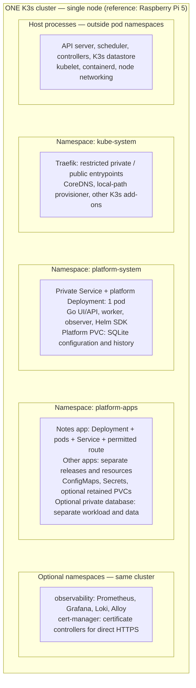
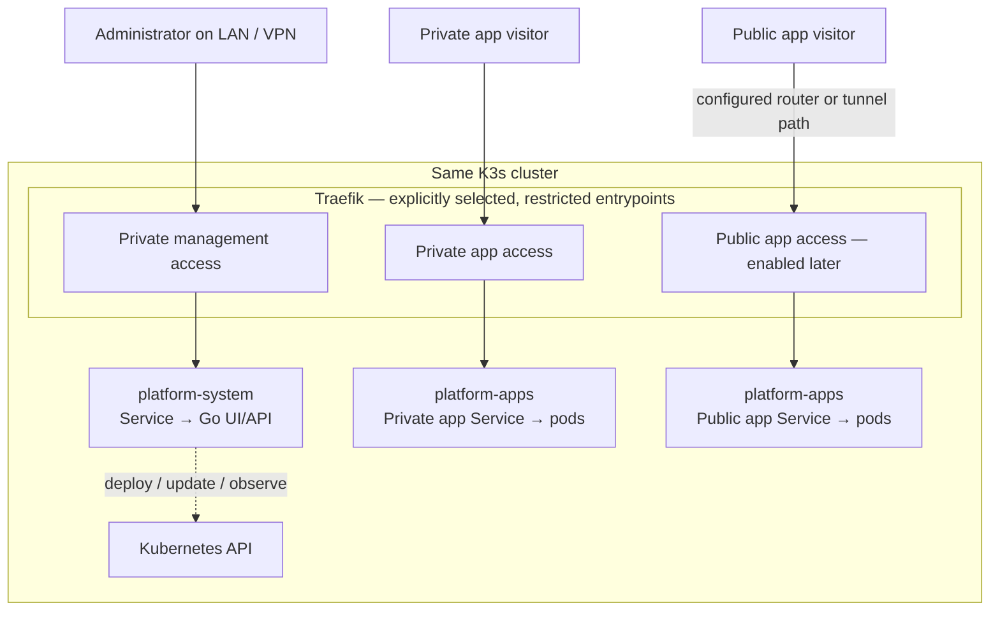
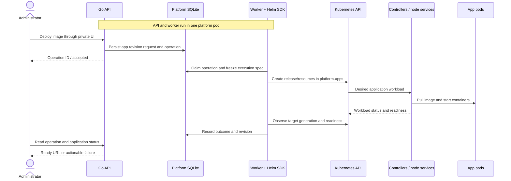

# Architecture, components, and scope

Part of the [application platform plan](app-plan.md). This document covers the
system shape (components, cluster layout, traffic paths) and the order in which
functionality is delivered. The API and data model are in
[api-and-data.md](api-and-data.md); networking and security are in
[networking-and-security.md](networking-and-security.md); install, recovery, and
observability are in [operations.md](operations.md).

## Deployment targets: host-agnostic by design

The platform installs on an administrator's own Linux machine. The reference and
starter host is a Raspberry Pi 5, but the platform is **not Pi-specific**. A
rented, internet-facing Linux server (VPS or dedicated, typically AMD64) is a
supported later target for the same platform.

The single-node K3s design is host-agnostic. The practical differences between
the Pi-at-home and a rented server are:

- **Architecture:** ARM64 on the Pi, usually AMD64 on a rented server. Platform
  and demonstration images are built for both (see
  [application contract](api-and-data.md#application-contract) and
  [operations.md](operations.md#cicd-and-release-artifacts)).
- **Capacity:** a rented server typically offers more CPU/RAM/disk than the
  32 GB-microSD Pi, relaxing the capacity constraints described in
  [operations.md](operations.md#reference-hardware-and-operating-limits).
- **Network reachability:** a rented server usually has a real public IP and
  direct inbound 80/443, making the direct-ingress public mode natural; the
  Pi-at-home often sits behind CGNAT and may need an outbound tunnel. See
  [networking-and-security.md](networking-and-security.md#public-mode-decision).

Nothing in the architecture below assumes the Pi. Where capacity or reachability
matters, the relevant document states the Pi-vs-server difference explicitly.

## Scope and order of delivery

Use three completion levels so that the first working version stays achievable.

| Level | Outcome | Included |
| --- | --- | --- |
| Local vertical slice | A real application works on the reference host through the platform. | Manual K3s bootstrap, API, minimal UI, image deployment, status, logs, LAN access, initial update and recovery path. |
| Usable platform | An administrator can operate applications without routine kubectl/Helm commands. | Authentication, public/private images, durable operations, history, reliable update/rollback, manual replicas, retained storage, documented installation and recovery. |
| Thesis demonstration / initial release | Another person can install it and reproduce the main scenarios. | One tested public HTTPS mode, the author's separate app, release artifacts, upgrade/backup procedures, observability evaluation, and repeatable tests. |

The supported starting workload is one long-running Linux HTTP container with
one application port. Add a private TCP service profile when testing a database
or another internal dependency. A frontend and backend can initially be two
applications connected through explicit configuration.

Defer these features until the core works:

- Building source repositories or Dockerfiles on the host; importing Docker Compose.
- Arbitrary user-supplied Helm charts, Kubernetes YAML, or shell commands.
- Multi-user organisations, public signup, billing, or isolation of untrusted tenants.
- Multi-cluster management, high availability, distributed storage, and node autoscaling.
- Automated database provisioning, migrations, backups for arbitrary database engines,
  and point-in-time recovery.
- A plugin marketplace, service mesh, canary deployments, and distributed tracing.
- CPU-based application autoscaling; manual replica changes come first.

Tests start with the first working lifecycle operation. Polished release
automation and a large test matrix can follow later.

## One cluster hosting the platform and its applications

The first installation has one Linux host, one K3s cluster, and one Kubernetes
node. That node performs both server/control-plane duties and workload execution.
The platform is itself deployed as a Kubernetes workload, alongside the
applications it manages. Deploying another application creates resources inside
this existing cluster; it does not create another cluster or start containers
inside the platform's own container.

K3s runs the API server, scheduler, controllers, datastore, and node services as
host-side components. Platform and application pods use the node's container
runtime. Those host processes are not pods in the platform namespace.
[K3s architecture](https://docs.k3s.io/architecture)

The following diagram shows the logical layout on the reference host. Namespace
boxes group Kubernetes resources; they are not separate machines or clusters.
Optional components appear to show where they will fit as milestones progress.

The platform database is a file used by the Go process on its own PVC, not another
database server. The optional application database is a separate workload and
volume; it is shown only as an example of a future app dependency. All persistent
data initially shares the host's physical storage even though the claims are separate.

### Namespace and resource layout

| Location | What belongs there | Managed by |
| --- | --- | --- |
| Host, outside workload namespaces | Linux services, K3s control plane/datastore, kubelet, container runtime, host configuration. | Administrator through installer and maintenance tooling. |
| `kube-system` | K3s-packaged ingress, cluster DNS, storage provisioner, and other system add-ons. | K3s and installer-controlled configuration. |
| `platform-system` | Platform Deployment/Service, service account, metadata PVC, platform settings; optional tunnel connector when selected. | Platform installation/upgrade chart. |
| `platform-apps` | One Helm release per managed app: Deployment, Service, configuration references, permitted route; separately owned Secrets and retained PVCs. | Go broker through Helm and its Kubernetes client. |
| `observability` | Optional monitoring/logging stack and its data volumes. | Installer-selected observability chart/profile. |
| `cert-manager` | Optional certificate controller workloads for direct HTTPS. Application Certificate objects and TLS Secrets remain with the relevant application/route. | Installer-selected certificate component. |
| Cluster-scoped resources | Node, PersistentVolumes, StorageClasses, and installation-level RBAC. | Installer/system controllers; the broker gets only explicitly required access. |

Each application has its own resource identity and Helm release even though apps
initially share `platform-apps`. Application IDs, labels, and exact resource
references prevent one app's update or deletion from touching another's resources.
Namespaces organize resources but do not themselves allocate hardware or block
network traffic. Use RBAC, network policies, and resource policies for those
boundaries. [Kubernetes namespaces](https://kubernetes.io/docs/concepts/overview/working-with-objects/namespaces/)

The same cluster could contain additional worker nodes later, with the platform
and apps scheduled onto appropriate nodes. This is a future topology change:
namespaces span the cluster, while node-local data and single-server availability
would need a separate migration/availability design.

## Management requests and application traffic

The platform manages applications through the Kubernetes API. Requests from
visitors to a deployed application go through ingress to that application's
Service/pods. The Go broker is not an application reverse proxy and does not need
to handle each visitor request.

The private management and private application paths may share a restricted
private listener with separate allowed routes. They never inherit the public
listener. The public path is present only after the administrator configures it;
the bootstrap SSH/port-forward path is omitted for clarity. The network
restrictions that make these access boundaries real are defined in
[networking-and-security.md](networking-and-security.md).

## How the platform deploys into its own cluster

The broker uses its pod's service account and in-cluster Kubernetes configuration.
The Go Kubernetes client and Helm SDK act on the same cluster API with that
identity. Do not mount the host's administrator kubeconfig into the broker.
The Helm SDK is a library in the Go process, not another management server.
[Accessing the Kubernetes API from a pod](https://kubernetes.io/docs/tasks/run-application/access-api-from-pod/)

The example shows the successful path. Failure, interrupted work, rollback, and
storage rules are defined in the [application contract](api-and-data.md#application-contract)
and [execution and recovery](operations.md#deployment-execution-recovery-and-reconciliation).
Cluster controllers maintain the platform Deployment itself in the same way they
maintain other workloads, so starting the platform does not depend on the
platform API already being available.

## Meaning of a managed platform on administrator-owned hardware

| Responsibility | What the product provides | What the administrator still owns |
| --- | --- | --- |
| Initial environment | Repeatable installation of the supported K3s and platform configuration. | A supported Linux host, access credentials, hardware, and initial network choices. |
| Application lifecycle | Image validation, deployments, configuration, updates, supported scaling, recovery, and history. | Suitable application images, app-specific settings, data model, and migration decisions. |
| Workload execution | Kubernetes scheduling, health-driven replacement, service discovery, and configured routing. | Sufficient hardware capacity and maintenance windows. |
| Cluster maintenance | Diagnostics and a documented, versioned upgrade/recovery procedure. | Scheduling and running OS/K3s maintenance; it is not automatic provider-operated cluster administration. |
| Data protection | Retained-volume behavior and tested backup/restore tooling or procedures. | Off-device backup destination, backup frequency, and verifying important app data can be restored. |
| Internet access | Automation for the chosen routing/TLS mode once its prerequisites are configured. | Domain/account ownership and any router, ISP, or tunnel-provider dependencies. |

Describe the product as a **self-hosted Kubernetes application platform with an
integrated installation and management experience**. This makes its managed
behavior explicit while keeping the existing single-administrator scope and
documented cluster-maintenance responsibilities.

## Shared resources, failures, and independent recovery

Platform services and applications share the host's CPU, memory, storage, and
network. Reserve measured capacity for Linux/K3s, ingress, and the broker before
setting the application budget. Apply a `ResourceQuota` and default/maximum
container requests/limits to `platform-apps`; include rolling-update surge pods
in admission calculations. These policies limit declared resource consumption,
but they do not provide physical isolation or enforce local-path disk quotas.
[Kubernetes resource quotas](https://kubernetes.io/docs/concepts/policy/resource-quotas/)

| Failure | Expected consequence and recovery boundary |
| --- | --- |
| Platform pod unavailable | UI/API and new operations are unavailable; existing apps normally continue if cluster, ingress, and their dependencies remain healthy. |
| An application fails | Its own readiness/availability changes; the platform should remain usable to inspect and recover it within the configured resource policy. |
| Ingress unavailable | Routed access is disrupted for apps and any UI routes using that controller; retain SSH-based recovery. |
| Kubernetes API unavailable | Broker cannot manage or reliably observe workloads; mark status stale. Do not assume running containers imply a healthy cluster. |
| Host, power, or physical storage fails | The shared installation is affected; this single-node design provides no machine-level high availability. |

Bootstrap, platform upgrades, and emergency recovery must remain runnable from
the host over SSH without the web UI. Install K3s first, then install the platform
as a workload. Keep the host-side recovery path even after the UI is complete.
The application lifecycle API manages `platform-apps`; it must not uninstall or
upgrade the platform, ingress, or cluster as though they were ordinary user apps.

## Platform modules and component responsibilities

The API, worker, and observer are modules inside **one Go service**. They do not
need independent microservices, a message broker, or separate deployments.
The browser communicates only with this service, never directly with Kubernetes.

| Component | Responsibility | Where it runs |
| --- | --- | --- |
| Installer | Host checks, K3s configuration, namespaces/RBAC, platform installation, initial admin access. | On the host, with explicit administrative privileges. |
| K3s | Kubernetes control plane and node services, scheduling, image pulling, networking, restarting containers. | Host service. |
| Web UI | Setup, application forms, status, logs, history, and lifecycle actions. | Built static assets served by the Go service. |
| Go API | Authentication, validation, application model, operation submission, API responses. | One platform pod. |
| Operation worker | Execute persisted deployment work and recover interrupted operations. | Background worker in the Go service. |
| Status observer | Read actual workload state and publish timestamped observations. | Background worker in the Go service. |
| SQLite | Persist platform users, specifications, operations, settings, and audit records. | Platform PVC; one writer process. |
| Helm adapter | Install and change a versioned first-party application chart. | Go Helm SDK, called by the worker. |
| Application chart | Produce standard workload, service, health, resource, and route manifests. | Versioned source shipped with the platform. |
| Traefik | Route HTTP traffic to the correct application. | K3s-provided ingress controller. |
| Certificate component | Issue and renew certificates for the selected direct HTTPS mode. | cert-manager when that mode is implemented. |
| Local storage provisioner | Supply node-local persistent volumes. | K3s storage component. |
| Registry | Store application and platform images. | GHCR, Docker Hub, or another configured registry. |
| Observability profile | Historical metrics/logs, dashboards, and selected alerts. | Optional services sized to the host. |

K3s supplies Traefik and ServiceLB; its default ingress setup uses host ports
80/443. Retain the bundled controller and configure it through supported K3s
mechanisms. Do not install a second public ingress controller by accident.
[K3s networking services](https://docs.k3s.io/networking/networking-services)

Use React with TypeScript as a proposed UI implementation. A static client is
enough; server-side rendering and a separate Node.js runtime are unnecessary for
this administration tool. [React TypeScript support](https://react.dev/learn/typescript)

### Three different kinds of database

| Database | Purpose | Initial choice |
| --- | --- | --- |
| K3s datastore | Kubernetes cluster objects and internal state. | K3s default SQLite for the single-server installation. |
| Platform database | Applications, requested revisions, operations, audit, sessions, and settings. | A separate SQLite database on a platform PVC. |
| Deployed application's database | Data belonging to the author's future application. | Decide when designing that application; possibly PostgreSQL or application-local SQLite. |

These databases have different owners and backup procedures. The platform's
database should not become a shared database for hosted applications.
[K3s datastore options](https://docs.k3s.io/datastore)

### Kubernetes ownership and permissions

Start with installer-created namespaces `platform-system` and `platform-apps`.
These are in the same cluster as `kube-system`. The first contains platform
components; the second contains managed applications. Optional add-ons use the
namespaces shown above. Use stable application IDs in resource names and labels.

- The installer performs cluster-level setup, including RBAC and ingress configuration.
- The running broker gets narrowly defined roles for the namespaces it manages,
  plus only the cluster reads required for capacity and diagnostics.
- Helm owns workload manifests; scaling, restarting, and updating all pass through
  the same chart configuration path.
- The broker owns versioned application Secrets and retained PVCs separately from
  the workload release. The chart refers to them by name.
- Application pods receive no Kubernetes API credentials by default.
- Users cannot use the UI to deploy arbitrary cluster-scoped resources.

One namespace per app is a possible later change. It is not required for a
single trusted administrator and would add namespace lifecycle privileges.
The first release is not a security boundary for hostile tenants or untrusted code.

## UI structure and user experience

Keep infrastructure terminology in diagnostic details. The main interface should
use **Application**, **Image**, **Version**, **Instances**, **URL**, and **Storage**.
Every action needs visible progress, a clear result, and a useful next step on failure.

| Screen | Main content and actions |
| --- | --- |
| Setup | Administrator creation, host checks, private access, LAN/DNS setup, optional registry login. |
| Overview | Host capacity, application summary, recent failed operations, disk/backup attention items. |
| Applications | Name, state, image version, URL, desired/ready instances; create button. |
| New application | Image-first form; sensible defaults; advanced configuration collapsed. |
| Application detail | Overview, logs/events, configuration, revision history, storage. |
| Registry credentials | Registry hostname, label, verification result, usage; add/rotate/remove credentials. |
| Activity | Deployment history and administrator audit events with filters. |
| Settings | Installation capabilities, networking, resource/retention policy, version and recovery information. |

### New application form

1. **Image:** paste a reference; optionally select a registry credential. Show a
   meaningful authentication, missing-tag, or architecture error.
2. **Application:** suggest a name; confirm the port. Offer a compact readiness
   setting with advanced options available.
3. **Access:** internal or LAN initially. Enable public only after installation
   networking is configured; explain the missing prerequisite beside the choice.
4. **Configuration:** environment values, masked secret input, optional storage.
5. **Review:** show version, URL plan, resource preset, instances, and persistent
   data behavior. Warn about expected downtime where applicable.
6. **Deploy:** immediately show a persistent operation with steps such as
   validating, preparing, pulling image, starting, checking health, and configuring access.

Status must survive navigation and refresh. Poll durable operation endpoints
first; add authenticated Server-Sent Events later if useful. Reconnecting should
refresh state from the API, not depend on receiving every event.

### Routine actions

| Action | Expected UI behavior |
| --- | --- |
| Update image/config | Show the proposed change and chosen failure policy before starting. |
| Scale | Set instance count; explain unsupported persistent/scaling modes or insufficient capacity. |
| Stop/start | Set replicas to zero/restore the chosen count through the same update flow. |
| Restart | Start a tracked restart and report readiness afterwards. |
| Rollback | Select an eligible successful revision; show what changes and what data stays unchanged. |
| Delete app | Name the app and show which volumes will be retained. |
| Delete retained volume | Separate destructive confirmation and in-use validation. |

Display logs as escaped plain text, with bounded history and streaming limits.
Differentiate application output from platform operation events. Do not promise
the platform can remove all secrets that an application itself prints to logs.
