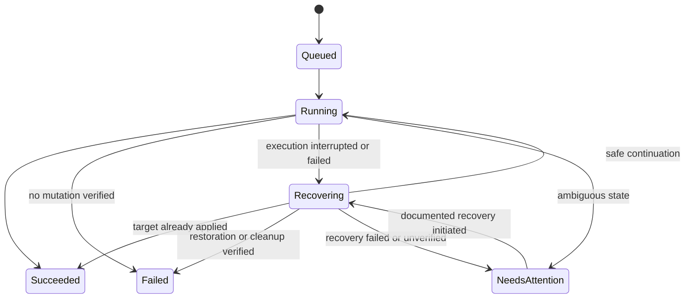

# Installation, operation execution, recovery, and observability

Part of the [application platform plan](app-plan.md). This document covers the
host/installer lifecycle, how operations execute and recover, and the
observability profiles. System architecture is described in [architecture.md](architecture.md);
the application contract and data model are in [api-and-data.md](api-and-data.md);
networking and secrets are in [networking-and-security.md](networking-and-security.md).

## Reference hardware and operating limits

The platform runs on an administrator's own Linux host. Two targets are in scope:

- **Raspberry Pi 5** — the initial reference host: 8 GB RAM, 32 GB microSD,
  64-bit Raspberry Pi OS, ARM64. Initial development requires neither a domain
  nor additional hardware purchases.
- **Rented internet server (VPS/dedicated)** — a supported later target, typically
  AMD64, usually with more capacity and a public IP. The platform is portable to
  it; see the [deployment-targets note in architecture.md](architecture.md#deployment-targets-host-agnostic-by-design).

K3s documents a 2-core/2-GB server baseline excluding application workloads and
recommends SSD storage on Raspberry Pi. An SSD is therefore a recommended later
improvement for sustained Pi use, subject to measured requirements. A rented
server with SSD-backed storage provides an alternative deployment target.
[K3s requirements](https://docs.k3s.io/installation/requirements)

The Pi's nominal 32 GB storage capacity is shared by the operating system,
platform, and applications. The following controls apply:

- Free disk capacity is measured after installation of the OS, K3s, and initial images.
- The full monitoring profile is optional, with bounded retention for images,
  application revisions, logs, and metrics.
- Reserved working space accommodates a new image while the previous image remains available.
- Disk pressure is displayed, and best-effort admission estimates reject new
  storage-heavy changes that would consume the configured reserve. Image expansion
  and later data growth still require monitoring; admission is not a disk quota.
- Image-cache management remains the responsibility of the container runtime;
  direct deletion of its files is prohibited.
- Admission thresholds are derived from reference-host measurements and recorded
  as versioned configuration. They do not constitute performance guarantees.
- Physical-host testing includes power supply, cooling, and storage health.

The lightweight profile is the default. Idle CPU/RAM usage, remaining disk
capacity, and the cost of one representative application are measured before the
full monitoring stack is enabled. Higher-capacity rented servers are evaluated
using the same measurement procedure.

## Installer workflow

The release package contains an installer, pinned component versions, the platform
chart, a checksums file, and installation documentation.
Initially the same installer can be run from a source checkout.

1. A read-only preflight checks OS and architecture, cgroups, disk/RAM, time sync,
   outbound registry access, occupied ports, and network CIDR conflicts.
2. Existing installations and clusters are detected. Overwriting an unrelated
   cluster is prohibited. Existing-cluster installation may be introduced as a
   separately tested future mode.
3. The installation summary identifies selected components and the persistent data
   location. Disk reformatting and implicit changes to unrelated firewall rules
   are prohibited.
4. A pinned K3s release is installed with recorded configuration and secrets encryption.
5. Namespaces, service accounts, RBAC, network rules, and the platform PVC are
   created. Public listeners remain disabled or blocked until public mode is
   explicitly configured, including on hosts with publicly routed IPv6 and
   internet-facing rented servers.
6. The platform Helm chart is installed and its readiness check is verified.
7. Initial management access is provided through an authenticated SSH tunnel or
   port forward. A single-use, expiring bootstrap token is displayed locally.
8. The setup wizard creates the administrator account and configures private
   management access, LAN routing, optional registry credentials, and retention.
9. Built-in diagnostics verify the installation, with an optional demonstration deployment.
10. Installation version and progress are persisted so subsequent installer runs
    can resume safely or report the failed stage.

Linux ARM64 on the Pi is the first validated target; Linux AMD64 is the second
validated target for rented-server deployment. Docker Engine is not required on
the installed host because K3s provides the container runtime. Images are built
with Docker/Buildx on a development machine or in CI.

The manual in-cluster platform installation is required in M2 before installer
automation in M7. Its chart includes the broker Deployment, Service, persistent
SQLite volume, service account, and restricted RBAC. Acceptance requires successful
in-cluster Kubernetes API access and retention of platform state after broker pod
replacement. Application-volume support in M5 is independent of this requirement.

## Upgrade and uninstall

Platform upgrades are separate from application updates. A host-side upgrade
command first backs up platform state, validates supported version transitions,
and then upgrades the platform chart. Database migrations must have a documented
compatibility or restore strategy; a Helm rollback alone cannot undo a database
migration. K3s upgrades follow a separate documented maintenance procedure.

The first release requires a documented upgrade path and failure recovery;
automatic upgrades through the UI are deferred. Platform uninstallation is
separate from application, volume, and K3s removal. Retained resources are reported,
and deletion of stored data requires an explicit action.

## CI/CD and release artifacts

GitHub Actions is the proposed CI provider, consistent with planned GitHub
distribution. Initial checks cover formatting/static analysis, meaningful Go
tests, frontend type/build checks, chart validation, and a small integration smoke
test. Images are built for both supported architectures: ARM64 for the Pi and
AMD64 for rented servers. Untrusted pull-request code must not execute on a host
serving deployed applications.

A tagged release publishes:

- The platform image to GHCR with version tags and recorded immutable digests.
- The application/platform charts and a compatibility manifest pinning their
  versions alongside K3s and other installed dependencies.
- Installer assets for the supported hosts, checksums, upgrade notes, and the
  clean-install procedure. Signed provenance may be added as release automation matures.
- Demonstration image versions used in smoke and recovery tests.

The separate application's pipeline builds, tests, and pushes its image. Initially
the administrator selects that version in the UI. The automation phase includes
an example deployment step that calls the same API with an application-scoped
token and polls the operation until completion or a `NeedsAttention` state.
A registry push alone must not implicitly update the running application.
[GitHub image publishing](https://docs.github.com/en/actions/tutorials/publish-packages/publish-docker-images)

The management endpoint remains private: automation requires an approved private-network
path, such as a VPN-connected runner or a dedicated trusted deployment runner.
Public administrative access is outside this integration. Machine tokens are
introduced with this automation phase, stored hashed, revocable, and
limited to the selected application's read/update/operation actions.
[GitHub private runner networking](https://docs.github.com/en/enterprise-cloud%40latest/actions/concepts/runners/private-networking)

## Deployment execution, recovery, and reconciliation

### Durable operation acceptance

SQLite provides the durable queue. A single worker initially executes mutations
serially across the installation, with at most one active operation per application.
The HTTP API and status observer remain responsive independently. In-memory
channels may wake the worker but must not be the only record of accepted work.

The request, candidate revision, operation, and audit event are stored transactionally.
The accepted request is durable immediately; its execution revision becomes
immutable after image resolution/normalization and before any Helm mutation.
The execution digest is frozen at that point and reused for any retry. Scale, restart,
configuration-only changes, and reapply preserve the current recorded digest;
rollback uses the selected revision's digest. They must not re-resolve a mutable
tag and implicitly change the application code. Stage transitions are recorded
before external actions.

No transaction spans SQLite, Helm, and Kubernetes. Execution therefore requires
safe re-execution and recovery based on observed state; exactly-once execution
is not guaranteed.

`NeedsAttention` is durable and nonterminal. The application's active operation
reference remains set, preventing conflicting lifecycle mutations with `409`.
This invariant applies both to failures during uninterrupted execution and to
recovery after a process restart. A timeout or failed recovery attempt cannot
release the operation block. Unrelated applications may proceed when the worker
can do so without affecting the unresolved operation.

### Normal deployment

1. Identity, application version, configured capabilities, and input limits are validated.
2. The accepted request is persisted and its operation ID is returned.
3. A newly selected image is resolved; other operations reuse the recorded digest.
   Architecture and available credential references are validated.
4. The normalized specification, image digest, chart version, and revision identity are frozen.
5. Referenced Secrets are verified and, where applicable, requested PVCs are
   created or reused with deterministic names and ownership labels.
6. The platform-owned chart is rendered with validated values.
7. Helm performs installation or upgrade with a bounded timeout and a recorded failure policy.
8. Rollout generation, ready instances, service endpoints, and requested routes are observed.
9. The revision is marked successful only after its completion conditions pass.
10. The result and sanitized diagnostics are published to history and the UI.

Completion depends on the action. A stop operation succeeds after the desired
generation is observed and application pods have stopped; it does not require ready
endpoints or a successful HTTP probe. Deletion succeeds after owned routes and
workloads are absent, with retained data still recorded. Deployment/update requires
the selected profile's readiness and managed exposure conditions; an independent
external reachability result remains a separate status.

Release/resource metadata contains operation and revision IDs and a configuration
hash so recovery can associate cluster changes with persisted intent.

### Failed update and rollback

For supported stateless updates, the previous successful configuration is
retained. A rollout deadline failure records the candidate revision as failed,
collects diagnostics, and moves the operation to **Recovering** before a
controlled restoration is attempted. The restored workload must be verified.

After verified restoration, the operation becomes **Failed**, with recovery
outcome **Previous version restored**. Effective desired state points to the
restored specification, and the failed candidate remains in history. The terminal
operation state, effective desired revision, and release of the application's
active operation reference are committed together.

If restoration fails or its outcome cannot be verified, the operation enters
**NeedsAttention** and retains the active operation reference. The attempted
revision remains failed, but the operation remains nonterminal. Diagnostics must
identify the unresolved state and the documented recovery procedure. An
interruption or broker restart is not required for this transition.

If validation fails before any cluster mutation, the operation can become
**Failed** after verification that the working release was unchanged. Failure
after a partially applied initial installation requires verified cleanup of owned
disposable resources before the operation can become terminal. Unverified cleanup
also requires **NeedsAttention**.

Automatic retries are bounded and restricted to classified transient failures.
Invalid configurations are not automatically resubmitted, and `NeedsAttention`
operations are not retried automatically. Explicit recovery follows the procedure
defined below.

Kubernetes reports stalled Deployments but does not automatically roll them back.
A pinned Helm SDK/tooling major and tested failure behavior are required; Helm 3
and Helm 4 expose different upgrade options.
[Deployment failure behavior](https://kubernetes.io/docs/concepts/workloads/controllers/deployment/#failed-deployment),
[Helm upgrade options](https://helm.sh/docs/helm/helm_upgrade/)

An explicit administrator rollback creates a new platform revision containing
the selected successful configuration and applies it as a tracked change.
Platform revision IDs remain distinct from Helm revision numbers. Validation
covers image/secret availability and incompatible storage changes. Data and
external services are not rolled back. Each supported rollback revision retains
its exact chart artifact and digest in addition to the chart version. If an
upgrade removes support for an earlier chart or schema, affected revisions are
marked ineligible and the required restore procedure is documented before the
platform upgrade is accepted.

### Broker restart and ambiguous operations

One broker replica uses a replacement policy that prevents concurrent workers
from accessing the same SQLite file. Startup examines every nonterminal operation:

- A persisted **NeedsAttention** operation retains its state and active operation
  reference. Startup does not automatically retry or dismiss it.
- An already applied target release is verified before completion of the existing operation.
- An operation with no applied changes may resume using the recorded specification and digest.
- A pending Helm release is inspected and recovered through a tested procedure,
  using the previous successful release where safe.
- An interrupted initial installation permits cleanup/retry only for owned
  disposable workload resources; independent Secrets, PVCs, and audit records are retained.
- Unverified recovery enters **NeedsAttention**, with diagnostics and a documented
  recovery action. Conflicting mutations remain blocked.

The documented recovery procedure for **NeedsAttention** requires an explicit
administrator action, records the recovery attempt, and transitions the same
operation to **Recovering**. The procedure inspects the persisted specification,
Helm history, and owned resources before applying a supported restoration or
cleanup. Verification must establish either successful completion of the original
target, an unchanged release, a restored previous configuration, or completed
cleanup. The corresponding terminal state and effective desired state are then
persisted together with release of the active operation reference. An unsuccessful
attempt returns to **NeedsAttention** and retains the block. No separate
unconditional unlock action is provided.

Deletion of Helm storage records solely to remove a lock is prohibited.
[Helm release states](https://helm.sh/docs/helm/helm_status/)

An existing application must continue running when the broker or its UI is
unavailable. Kubernetes handles ordinary pod replacement. The observer reports
drift or deleted resources; the initial version offers explicit **Reapply** using
`POST /api/v1/apps/{id}/reapply` and the same update mechanism. Operator changes
made during troubleshooting are not overwritten automatically.

## Observability profiles

### Lightweight profile: initial implementation

- Structured broker logs with request, application, and operation IDs.
- Durable operation history and audit events in SQLite.
- Current workload status, recent Kubernetes events, and bounded pod logs in the UI.
- Current resource usage from an available metrics API, with a clear unavailable state.
- Basic platform counters/histograms exposed privately for later scraping.
- Visible disk usage and bounded log/image/history retention policies.

Recent pod logs do not provide a durable searchable log archive. The UI and
documentation state the limits of log availability after restarts or pod replacement.

### Full monitoring profile: optional extension

The full profile adds Prometheus, Grafana, Loki, and Grafana Alloy for log
collection. Retention is explicitly bounded, and additional CPU/RAM/storage usage
is measured. Grafana Alloy is the selected collector; Promtail reached
end of life in March 2026. [Grafana's Promtail lifecycle notice](https://grafana.com/docs/loki/latest/send-data/promtail/)

Initial dashboards cover deployment outcomes/duration, API errors/latency,
workload restarts, ready replicas, host resource pressure, and free disk. Selected
alerts cover repeated failed deployments and sustained resource pressure.
Monitoring UIs remain private. High-cardinality metric labels, including request
IDs and unrestricted application log values, are excluded.

This profile extends the observability capabilities of the lightweight profile.
The required core evaluation uses measurements available without the full stack;
M8 adds monitoring overhead and extended experiments. A higher-capacity rented
server may support longer retention, subject to the same measurements.
Distributed tracing remains optional and is distinct from the required audit history.
