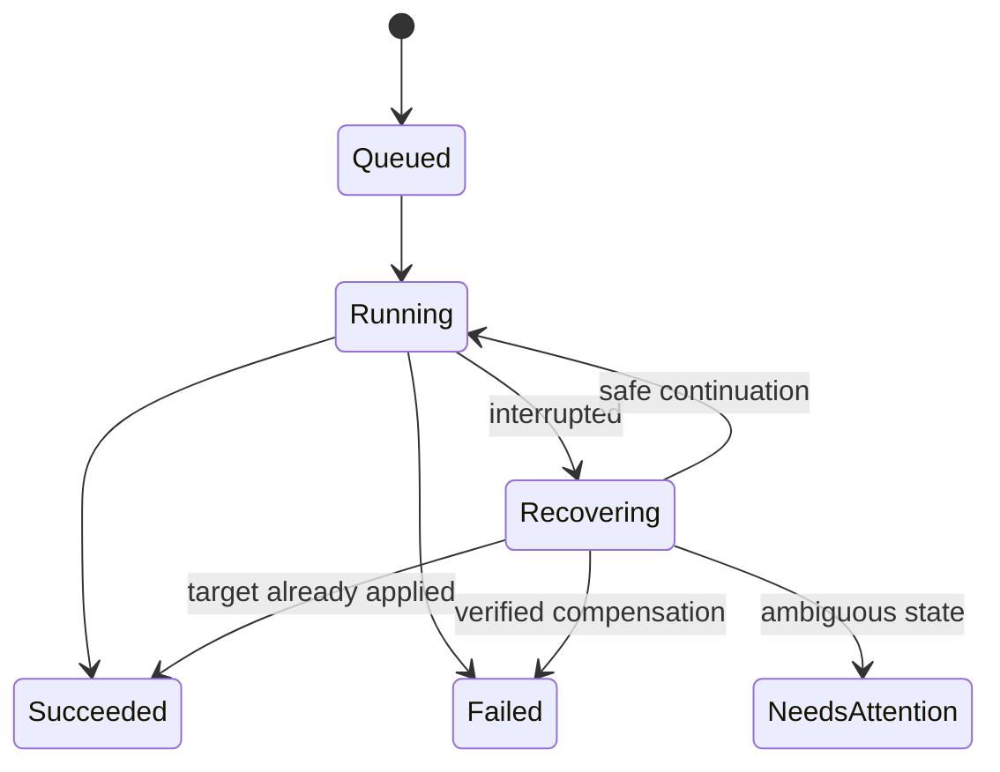

# Operations: install, execution/recovery, observability

Part of the [application platform plan](app-plan.md). This document covers the
host/installer lifecycle, how operations execute and recover, and the
observability profiles. System shape is in [architecture.md](architecture.md);
the application contract and data model are in [api-and-data.md](api-and-data.md);
networking and secrets are in [networking-and-security.md](networking-and-security.md).

## Reference hardware and operating limits

The platform runs on an administrator's own Linux host. Two targets are in scope:

- **Raspberry Pi 5** — the reference/starter host: 8 GB RAM, 32 GB microSD,
  64-bit Raspberry Pi OS, ARM64. Used for early development; needs no domain or
  additional purchases to start.
- **Rented internet server (VPS/dedicated)** — a supported later target, typically
  AMD64, usually with more capacity and a public IP. The platform is portable to
  it; see the [deployment-targets note in architecture.md](architecture.md#deployment-targets-host-agnostic-by-design).

K3s documents a 2-core/2-GB server baseline excluding application workloads and
recommends SSD storage on Raspberry Pi. An SSD is therefore a recommended later
improvement for sustained Pi use, subject to actual measurements and the author's
decision. A rented server with SSD-backed storage sidesteps this concern.
[K3s requirements](https://docs.k3s.io/installation/requirements)

On the Pi, treat 32 GB as a capacity constraint, not as 32 GB freely available to
apps:

- Measure free disk after the OS, K3s, and initial images are installed.
- Keep monitoring optional and retention short; do not retain unlimited images,
  application revisions, logs, or metrics.
- Reserve working space for pulling a new image while retaining the old one.
- Display disk pressure and use best-effort admission estimates to reject new
  storage-heavy changes that would consume the configured reserve. Image expansion
  and later data growth still require monitoring; admission is not a disk quota.
- Let the container runtime manage its image cache; never delete its files directly.
- Set admission thresholds after measuring the reference host, and record them as
  versioned configuration rather than unsupported performance guarantees.
- Check power supply, cooling, and storage health during physical-host testing.

Default to a lightweight profile. Measure idle CPU/RAM, remaining disk, and the
cost of one representative app before enabling the full monitoring stack. A
higher-capacity rented server relaxes these limits but the same measure-first
discipline applies.

## Installer workflow

The eventual downloaded package should contain an installer, pinned component
versions, the platform chart, a checksums file, and installation documentation.
Initially the same installer can be run from a source checkout.

1. Run a read-only preflight: OS and architecture, cgroups, disk/RAM, time sync,
   outbound registry access, occupied ports, and network CIDR conflicts.
2. Detect an existing installation or cluster. Refuse to overwrite an unrelated
   cluster. Existing-cluster installation can be a separately tested future mode.
3. Show what will be installed and the selected persistent data location. Do not
   reformat disks or silently rewrite unrelated firewall configuration.
4. Install a pinned K3s release with recorded configuration and secrets encryption.
5. Create namespaces, service accounts, RBAC, network rules, and the platform PVC.
   Keep public listeners disabled or blocked by default until public mode is
   explicitly configured, including on hosts with publicly routed IPv6. This is
   especially important on an internet-facing rented server.
6. Install the platform Helm chart and wait for its readiness check.
7. Provide initial management access over an authenticated SSH tunnel/port forward.
   Show a single-use, expiring bootstrap token to the local administrator.
8. The setup wizard creates the administrator account and configures private
   management access, LAN routing, optional registry credentials, and retention.
9. Run a built-in diagnostic and offer to deploy the demonstration image.
10. Store installation version and progress so rerunning the installer can resume
    safely or explain the failed stage.

Support Linux ARM64 first on the Pi and verify Linux AMD64 as the second target
— the AMD64 path is what makes the rented-server deployment real, so treat it as
a first-class verified target, not an afterthought. Docker Engine is not required
on the installed host: K3s runs the containers. Use Docker/Buildx on a
development machine or CI to produce images.

## Upgrade and uninstall

Keep platform upgrades separate from application updates. A host-side upgrade
command first backs up platform state, validates supported version transitions,
and then upgrades the platform chart. Database migrations must have a documented
compatibility or restore strategy; a Helm rollback alone cannot undo a database
migration. Upgrade K3s through a separate documented maintenance procedure.

The first release needs a documented upgrade path and failure recovery, not a
self-updating UI. Uninstall the platform separately from applications, volumes,
and K3s. Report what will remain; deleting stored data must be an explicit action.

## CI/CD and release artifacts

Use GitHub Actions as the proposed CI provider because distribution is planned
through GitHub. Start with formatting/static checks, meaningful Go tests, frontend
type/build checks, chart validation, and a small integration smoke test. Build
images for both supported architectures (ARM64 for the Pi, AMD64 for the rented
server) without running untrusted pull-request code on a host that serves real
applications.

For a tagged release, publish:

- The platform image to GHCR with version tags and recorded immutable digests.
- The application/platform charts and a compatibility manifest pinning their
  versions alongside K3s and other installed dependencies.
- Installer assets for the supported hosts, checksums, upgrade notes, and the
  clean-install procedure. Add signed provenance as release automation matures.
- Demonstration image versions used in smoke and recovery tests.

The separate application's pipeline builds, tests, and pushes its image. Initially
the administrator selects that version in the UI. Later, provide one example
deployment step that calls the same API with an app-scoped token, then polls the
operation until it succeeds or fails. A registry push alone must not silently
update the running app. [GitHub image publishing](https://docs.github.com/en/actions/tutorials/publish-packages/publish-docker-images)

Keep the management endpoint private: automation needs an approved private-network
path, such as a VPN-connected runner or a dedicated trusted deployment runner.
Do not open administration to the Internet just to make CI reach it. Machine
tokens are introduced with this automation phase, stored hashed, revocable, and
limited to the selected app's read/update/operation actions.
[GitHub private runner networking](https://docs.github.com/en/enterprise-cloud%40latest/actions/concepts/runners/private-networking)

## Deployment execution, recovery, and reconciliation

### Persist work before executing it

Use SQLite as the durable queue. A single worker initially executes mutations
serially across the installation, with at most one active operation per app.
The HTTP API and status observer remain responsive independently. In-memory
channels may wake the worker but must not be the only record of accepted work.

Transactionally store the request, candidate revision, operation, and audit event.
The accepted request is durable immediately; its execution revision becomes
immutable after image resolution/normalization and before any Helm mutation.
Freeze the execution digest at that point; a retry must reuse it. Scale, restart,
configuration-only changes, and reapply preserve the current recorded digest;
rollback uses the selected revision's digest. They must not re-resolve a mutable
tag and accidentally change the application code. Record stage transitions
before external actions.

There is no transaction spanning SQLite, Helm, and Kubernetes. Design for
re-execution and observed recovery rather than claiming exactly-once execution.

### Normal deployment

1. Validate identity, app version, configured capabilities, and input limits.
2. Persist the accepted request and return its operation ID.
3. Resolve a newly selected image, or reuse the recorded digest for other operations;
   validate architecture and available credential references.
4. Freeze normalized spec, image digest, chart version, and revision identity.
5. Ensure referenced Secrets/PVCs exist using deterministic names and ownership labels.
6. Render the platform-owned chart with validated values.
7. Install or upgrade through Helm with a bounded timeout and recorded failure policy.
8. Observe rollout generation, ready instances, service endpoints, and requested routes.
9. Mark the revision successful only when its completion conditions pass.
10. Publish the result and sanitized diagnostics to history and the UI.

Completion depends on the action. A stop operation succeeds after the desired
generation is observed and app pods have stopped; it does not require ready
endpoints or a successful HTTP probe. Deletion succeeds after owned routes and
workloads are absent, with retained data still recorded. Deployment/update requires
the selected profile's readiness and managed exposure conditions; an independent
external reachability result remains a separate status.

Store operation/revision IDs and a configuration hash in release/resource
metadata so recovery can relate cluster changes to persisted intent.

### Failed update and rollback

For supported stateless updates, preserve the previous successful configuration.
When the new version fails its rollout deadline, collect diagnostics and attempt
a controlled restoration of that configuration. Verify the restored workload.
The update operation remains **Failed**, with a separate recovery outcome such
as **Previous version restored** or **Recovery needs attention**.

If validation fails before any cluster mutation, fail the request's operation
without attempting a rollback of the unchanged working release.

After verified restoration, point effective desired state to the restored spec;
keep the failed candidate in history. Otherwise a reconciliation loop could keep
trying to reinstall the broken version. Do not automatically rerun invalid
configuration forever. Retries are bounded and limited to transient failures.

Kubernetes reports stalled Deployments but does not automatically roll them back.
Pin a Helm SDK/tooling major and test its failure behavior; Helm 3 and Helm 4
expose different upgrade options. [Deployment failure behavior](https://kubernetes.io/docs/concepts/workloads/controllers/deployment/#failed-deployment),
[Helm upgrade options](https://helm.sh/docs/helm/helm_upgrade/)

For explicit user rollback, create a new platform revision containing the chosen
successful configuration and apply it as a tracked change. Keep platform revision
IDs distinct from Helm revision numbers. Validate image/secret availability and
any incompatible storage changes. Data and external services are not rolled back.
Retain the exact chart artifact and its digest for every supported rollback
revision, not just its version string. If an upgrade removes support for an old
chart/schema, explicitly mark affected revisions ineligible and explain the
required restore procedure before accepting that platform upgrade.

### Broker restart and ambiguous operations

Run one broker replica with a replacement policy that prevents concurrent workers
using the same SQLite file. On startup, inspect every nonterminal operation:

- If the target release is already applied, verify it and finish the existing operation.
- If no change occurred, resume using the recorded spec and digest.
- If Helm reports a pending release, inspect its state and recover through a
  tested procedure, using the previous successful release where safe.
- If an initial install was interrupted, cleanup/retry only owned disposable
  workload resources; preserve independent Secrets, PVCs, and audit records.
- If safe recovery cannot be established, enter **Needs attention** and block
  conflicting mutations. Provide diagnostics and a documented recovery action.

Do not delete Helm storage records blindly to clear a lock.
[Helm release states](https://helm.sh/docs/helm/helm_status/)

An existing application should continue running when the broker or its UI is
unavailable. Kubernetes handles ordinary pod replacement. The observer reports
drift or deleted resources; the initial version offers explicit **Reapply** using
`POST /api/v1/apps/{id}/reapply` and the same update machinery instead of silently
overwriting operator troubleshooting.

## Observability sized for the host

### Lightweight profile: first working version

- Structured broker logs with request, application, and operation IDs.
- Durable operation history and audit events in SQLite.
- Current workload status, recent Kubernetes events, and bounded pod logs in the UI.
- Current resource usage from an available metrics API, with a clear unavailable state.
- Basic platform counters/histograms exposed privately for later scraping.
- Visible disk usage and bounded log/image/history retention policies.

Recent pod logs are not a durable searchable log archive. Report the distinction
instead of implying complete history after restarts or pod replacement.

### Full evaluation profile: after core deployment works

Add Prometheus, Grafana, Loki, and Grafana Alloy for log collection. Use short,
explicitly bounded retention and measure the additional CPU/RAM/storage usage.
Use Alloy rather than starting a new Promtail installation: Promtail reached
end of life in March 2026. [Grafana's Promtail lifecycle notice](https://grafana.com/docs/loki/latest/send-data/promtail/)

Start with dashboards for deployment outcomes/duration, API errors/latency,
workload restarts, ready replicas, host resource pressure, and free disk. Add
selected alerts for repeated failed deployments and sustained resource pressure.
Keep monitoring UIs private and avoid high-cardinality metric labels such as
request IDs or unrestricted application log values.

This retains the observability goal in the original outline while allowing the
32 GB reference machine to run a measured, practical first version. A
higher-capacity rented server can afford longer retention, measured the same way.
Distributed tracing remains optional and is distinct from the required audit history.
