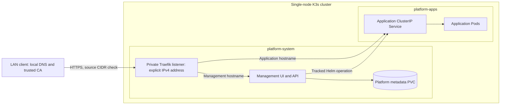

# Private LAN HTTPS

This optional installation mode provides private management and application URLs
in the same single-node K3s cluster. Published v0.1.8 passed reference-Pi LAN
routing, normal browser certificate trust, UI/API application deployment,
source/listener isolation, same-version retention and reboot. The
[native report](../tests/experiments/2026-11-24-v0.1.8-native.md) records these checks
and the published installer's `--check` exit-status defect. Its correction passed
the [v0.1.9 native gate](../tests/experiments/2026-11-24-v0.1.9-native.md), including
normal browser deployment and original session/config retention through reinstall
and reboot. Separate rollout-adjacent browser timeout observations remain in that
report; uninterrupted rolling HTTP service has not been established. Source results are recorded separately in [status](status.md).



## Listener and certificate contract

The private gateway binds one explicit RFC1918 IPv4 address on a port from 1024
to 65535; the default is 8443. No wildcard-address, IPv6, public HTTP/HTTPS,
LoadBalancer or NodePort listener is created. A mandatory source-CIDR middleware
uses the actual connection peer. Forwarded headers and PROXY protocol are not
trusted. The `platform-private` IngressClass and explicit `private` entrypoint
separate these routes from other controllers. Unknown SNI is refused and unknown
hosts beneath the application domain have no route.

The installation is intended for a dedicated single-node host. Reserve its LAN
address through DHCP or static configuration. On an internet-facing server,
private access requires a private network/VPN address and corresponding source
CIDRs. Forwarding this listener through a router that rewrites every client to an
allowed LAN address defeats source distinction; such forwarding is outside this
mode. Public hosting remains M6 scope.

The gateway is trusted infrastructure: it uses host networking to bind the chosen
address, and read-only ingress-provider permissions include Services, EndpointSlices,
Ingresses and Secrets in `platform-system` and `platform-apps`. It has read-only
cluster access to Nodes/IngressClasses, no resource-write permissions, no access
to other namespaces, a non-root container and dropped capabilities. Application
Pods retain the restricted namespace policy and do not gain host networking.

TLS 1.2 or newer is required. An existing `kubernetes.io/tls` Secret in
`platform-system` contains the server certificate/chain and matching unencrypted
private key. Certificates/keys are not passed through Helm values. The certificate
must cover the management hostname and exact wildcard application domain, remain
valid for at least 24 hours and match the key. Trust, chain verification and
client clocks must also be correct. No automatic issuer or renewal controller is
installed. Traefik v3.7.19 is pinned by multi-architecture image-index digest; the
optional image is pulled from Docker Hub when LAN mode is enabled and is not in
the native OCI bundle. Internet access is therefore required for its first pull.

The listener's mandatory middleware and TLS defaults follow the
[Traefik entrypoint contract](https://doc.traefik.io/traefik/v3.7/reference/install-configuration/entrypoints/);
source selection uses the default remote-address behavior of
[IPAllowList](https://doc.traefik.io/traefik/v3.7/reference/routing-configuration/http/middlewares/ipallowlist/).

## 1. Install and bootstrap through SSH

Complete the [native installation](installation.md), create the administrator
through the loopback bootstrap and verify a healthy cluster. LAN is configured
after installation so that its TLS Secret can be created explicitly. This does
not enable cross-version upgrades or replace unrelated installations.

On the Pi, define the installer-owned command if it is not already available:

```bash
pkubectl() {
  sudo /usr/local/lib/k8s-internal-platform/kubectl \
    --kubeconfig /etc/rancher/k3s/k3s.yaml "$@"
}
```

## 2. Provide the certificate

An existing institutional/domain certificate may be used if it covers both
required names. The following example creates a small private CA on the
administrator's workstation using OpenSSL 3. Replace the names consistently
before execution. The CA private key remains on the workstation; only the leaf
certificate/key are transferred to the Pi. Existing PKI files must not be overwritten.

```bash
set -e
umask 077
mkdir -p platform-lan-pki
cd platform-lan-pki
test ! -e ca.key && test ! -e tls.key
openssl req -x509 -newkey rsa:3072 -nodes -sha256 -days 3650 \
  -subj '/CN=Platform LAN CA' -keyout ca.key -out ca.crt \
  -addext 'basicConstraints=critical,CA:TRUE' \
  -addext 'keyUsage=critical,keyCertSign,cRLSign'
openssl req -newkey rsa:2048 -nodes -sha256 \
  -subj '/CN=platform.home.arpa' -keyout tls.key -out tls.csr
cat > leaf.ext <<'CERTIFICATE'
basicConstraints=critical,CA:FALSE
keyUsage=critical,digitalSignature,keyEncipherment
extendedKeyUsage=serverAuth
subjectAltName=DNS:platform.home.arpa,DNS:*.apps.home.arpa
CERTIFICATE
openssl x509 -req -in tls.csr -CA ca.crt -CAkey ca.key -CAcreateserial \
  -out tls.crt -days 365 -sha256 -extfile leaf.ext
openssl verify -CAfile ca.crt -verify_hostname platform.home.arpa tls.crt
openssl x509 -in ca.crt -noout -fingerprint -sha256
```

Transfer `tls.crt` and `tls.key` over SSH into a private directory on the Pi.
Substitute the actual SSH destination:

```bash
ssh USER@PI_HOST 'umask 077; mkdir -p ~/platform-lan-pki; chmod 700 ~/platform-lan-pki'
scp tls.crt tls.key USER@PI_HOST:platform-lan-pki/
```

On the Pi, create the Secret. `create` refuses an existing object rather than
overwriting unrelated state. Do not print its YAML/JSON in shared logs.

```bash
chmod 600 ~/platform-lan-pki/tls.key
pkubectl -n platform-system create secret tls platform-private-tls \
  --cert="$HOME/platform-lan-pki/tls.crt" --key="$HOME/platform-lan-pki/tls.key"
```

## 3. Enable the private listener

On the Pi, create `private-lan.json`. The following address/CIDR is an example and
must match the host and permitted client network. Only the documented fields are
accepted. The application domain and management hostname must be separate.

```json
{
  "address": "192.168.68.227",
  "httpsPort": 8443,
  "allowedCIDRs": ["192.168.68.0/24"],
  "managementHostname": "platform.home.arpa",
  "applicationDomain": "apps.home.arpa",
  "tlsSecretName": "platform-private-tls"
}
```

From the directory containing the verified installer:

```bash
PLATFORM_VERSION="$(sudo awk -F= '$1 == "PLATFORM_VERSION" {print $2}' /etc/k8s-internal-platform/release.env)"
sudo bash install.sh --version "$PLATFORM_VERSION" --lan-config private-lan.json --check
sudo bash install.sh --version "$PLATFORM_VERSION" --lan-config private-lan.json
```

Python 3, OpenSSL and iproute2 are additional prerequisites for this opt-in mode. The
installer checks that the selected bundle supports LAN mode, that the bind
address belongs to the host, and that the existing Secret is valid before Helm changes, enables Secure cookies
and persists validated configuration under `/etc/k8s-internal-platform/` with mode
0600. LAN changes use Helm atomic rollback and cleanup-on-failure against the
existing platform release; failed readiness is not accepted as configuration
success. Subsequent same-version reruns retain it even without `--lan-config`.
Changing installed LAN settings is deliberately refused; network migration and
automatic certificate rotation are not implemented. A failed installation must
be diagnosed from the failed Helm revision and gateway logs, rather than deleting
metadata or Helm records.

## 4. Configure client DNS and certificate trust

Kubernetes DNS does not configure the router or client operating system. Add local
DNS records on the router/resolver:

| Record | Example value |
| --- | --- |
| `platform.home.arpa` A | `192.168.68.227` |
| `*.apps.home.arpa` A | `192.168.68.227` |
| AAAA | None for this IPv4-only listener. |

For an initial demonstration, a hosts-file entry on the separate client is
sufficient for the explicitly named application:

```text
192.168.68.227 platform.home.arpa demo.apps.home.arpa
```

Hosts files do not provide wildcard DNS. Each additional app requires its own
entry unless the router/resolver supplies wildcard DNS.

Distribute only the public `ca.crt` to client devices and compare its SHA-256
fingerprint through a trusted channel before installation. On macOS, import the
CA into Keychain Access and explicitly configure SSL trust, following
[Apple's certificate trust instructions](https://support.apple.com/en-ca/guide/keychain-access/kyca11871/mac).
Browsers with an independent certificate store require that store to trust the CA.
A warning bypass is not successful certificate-trust acceptance. System trust is
an explicit administrator action; the platform does not change a workstation's
trust store. The CA key must not be distributed.

## 5. Verify from another LAN device

On the client, verify the real DNS route and certificate without disabling TLS
validation:

```bash
curl --noproxy '*' --cacert ca.crt -fsS https://platform.home.arpa:8443/readyz
```

The expected result is `status: ready` and `cluster: available`. An unauthenticated
`/api/v1/system` request must return 401. Open the same HTTPS hostname in the
trusted browser and sign in. The session cookie must be Secure, HttpOnly,
SameSite=Strict and limited to the management hostname. Existing plain-HTTP API
cookie jars must be replaced by a fresh HTTPS login.

In **New application**, select **Private LAN**, provide a single-label hostname
such as `demo.apps.home.arpa`, and deploy an inspectable compatible image. The
details page displays the configured HTTPS URL after reload. The API also returns
`access` from the last successful revision, using the initial desired revision
only when no successful revision exists. This is configuration, not a claim that
client DNS/TLS/reachability has been verified. Images imported only through the
native bundle remain an [API deployment workflow](user/api-reference.md), because
the image-inspection wizard requires a registry.

Verify actual application content from that separate client, for example:

```bash
curl --noproxy '*' --cacert ca.crt -fsS https://demo.apps.home.arpa:8443/version
```

The `/version` endpoint exists on the bundled demo; use the deployed image's own
endpoint for other images. Internal applications create no route. The API refuses
management/outside/nested hostnames and a hostname reserved by another live app's
pending/successful rollback history. Deleting the owner releases that reservation.
Current source accepts version-guarded PATCH changes between Internal and LAN,
and LAN hostname changes, through the tracked revision path. The effective URL
continues to identify the last successful revision until the candidate succeeds.
Failed changes restore the previous managed configuration and verify the expected
route or its absence before unlocking. Failed preparation or verification retains
`needs_attention`; recovery retry restores the previous successful snapshot.
Published v0.1.9 retains the earlier 422 transition guard. The new transition and
failure tests require their own published-release/native validation.

Negative acceptance must include an excluded source network, forged
`X-Forwarded-For`/`Forwarded` headers, an unknown host/SNI and IPv6. The source
suite exercises actual traffic and refuses an untrusted CA. Its browser uses an
isolated fixture-certificate pin, with CA/hostname validation checked independently;
it does not install OS trust or establish native second-device browser acceptance.

## SSH fallback, renewal and diagnosis

After enabling Secure cookies, preserve TLS when forwarding administration.
From the workstation, forward to the configured gateway address/port:

```bash
ssh -N -L 127.0.0.1:8443:192.168.68.227:8443 USER@PI_HOST
curl --noproxy '*' --cacert ca.crt \
  --resolve platform.home.arpa:8443:127.0.0.1 \
  -fsS https://platform.home.arpa:8443/readyz
```

The SSH connection originates on the Pi; its source address must be covered by
the allowlist. A browser fallback additionally requires that the management name
resolve to loopback for that session, with ordinary certificate trust retained.
The original HTTP/SSH bootstrap remains the initial installation path; this TLS
forward is the authenticated fallback once LAN mode is enabled.

Before expiration, issue a replacement leaf certificate with the same SANs and
matching key. An administrator replaces the contents of the explicitly owned
TLS Secret, restarts `deployment/platform-private`, waits for readiness and repeats
client verification. The CA can remain trusted while the leaf is renewed.

Diagnosis should distinguish gateway scheduling/image pull, address/port binding,
DNS, CA/chain/expiry/SNI, source restriction (403), absent route (404), endpoint
availability (502/503) and broker authentication (401). Read gateway logs with
`pkubectl -n platform-system logs deployment/platform-private`; inspect the owned
Deployment/Ingress and the failed Helm revision. Never print TLS Secret data or
delete release records to turn failed acceptance into a pass.
